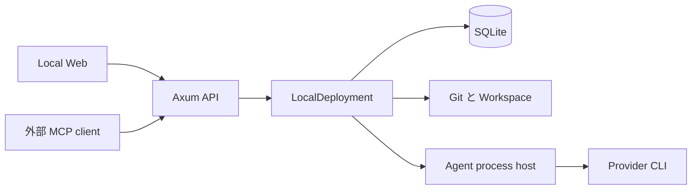

# システム境界と起動順序

LVK は [Kanban board](../concepts/project-and-issue.md) で仕事を管理し、ホスト上の Git と coding agent を使って実行する self-hosted 製品である。システムを横断する変更や起動障害の調査時に、所有者と保存先を区別するための入口である。[README](../../README.md)・[操作の段階](../quickstart.md#操作の段階)

## 責任と保存先

`server` は HTTP・WebSocket と製品操作を受け、`server-access` は認証とメンバーを扱う。`Deployment` の実装である `LocalDeployment` は DB、Git、Workspace、実行 port などを組み立てる。`executors` は provider の通信を扱い、独立 host は実プロセスと監査を所有する。[server](../../crates/server/src/lib.rs)・[組立](../../crates/local-deployment/src/lib.rs)・[Agent Runtime](agent-runtime.md)

`workflow` はグラフの契約を持ち、server と service の runtime は永続化と副作用を伴う進行を担当する。外部 MCP は製品操作を公開する。[Workflow](workflow-runtime.md)・[外部アクセス](../integrations/remote-access.md)

SQLite は Board、実行の canonical 状態、確定 Change Manifest などを保持する。Git worktree、Native Audit、Repository Memory の作業用 journal やユーザーの共有成果物は別の寿命を持つ。DB のコピーだけでそれらを復元できると仮定しない。[記憶の境界](../concepts/repository-memory.md)・[サーバーのバックアップ](../operations/server-container.md)

DB 起動は SQLx migration と Agent Runtime schema guard を実行する。Project key の既知の履歴について互換 migration source を選ぶが、未知の不整合を一般に修復するものではない。通常の SQLite busy timeout は5秒である。[DB 初期化](../../crates/db/src/lib.rs)・[互換選択](../../crates/db/src/migration_compat.rs)

Web と stdio MCP は同じローカル Board データを別の応答契約で利用する。歴史的な `local_remote` や `remote-types.ts` という名前は Cloud backend の存在を意味しない。[router](../../crates/server/src/routes/mod.rs)・[Web の同期](web-and-sync.md)

## 起動と回復

Standalone とライブラリーの起動経路は共通の local deployment を組み立てる。現行配布は Docker のサーバーであり、ライブラリー API の存在を退役した desktop shell の稼働と混同しない。[配布](../../README.md)・[起動 API](../../crates/server/src/startup.rs)

回復は実プロセスの所有者から外側へ進む。

1. Deployment 構築時に provider host を再照合する。
2. 永続化された Agent Run command を再照合する。
3. Setup launch gate を再照合する。
4. orchestration の outbox・inbox・lease と Workflow Run を再照合する。
5. OpenWiki、Workflow completion watcher、定時処理を起動する。

旧 ExecutionProcess の孤児処理は、新しい Agent Run の生存中 host を誤判定し得るため、この回復には流用しない。Standalone とライブラリーの両入口を変更時に確認し、片方の monitor 配線を他方にもあると仮定しない。[embedded 起動](../../crates/server/src/startup.rs)・[standalone 起動](../../crates/server/src/main.rs)

## 変更時の境界

公開サーバーの HTTPS、認証、永続 volume は[サーバー運用](../operations/server-container.md)で扱う。認証の状態と provider のログインは別である。[サーバー認証](../concepts/server-access.md)・[provider](../integrations/agent-providers.md)

Rust の公開型は TypeScript に生成されるため、API の変更は Web の利用側も含めて検証する。開発用 Cargo と SQLx の具体的なコマンドは[開発・検証](../operations/development.md)に置く。[型生成](../../crates/server/src/bin/generate_types.rs)・[package scripts](../../package.json)

Project の SQLite 移送は選択した Project データの追加 import であり、インスタンス全体のバックアップや Git・worktree の移送ではない。[Project 移送](../concepts/project-transfer.md)

DB 起動 fixture は migration と schema の回帰を検査するが、実サーバーの復元や外部 provider の受入を証明しない。[起動テスト](../../crates/db/tests/startup.rs)
