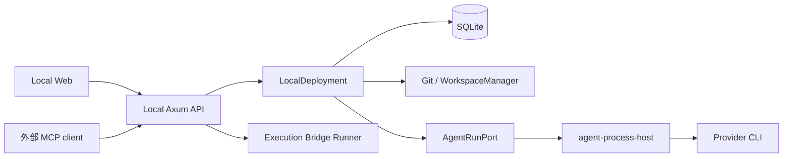

# システム境界と起動順序

LVK は、作業要求を管理する画面と、実際のファイル・Git・coding agent を動かすホストを組み合わせる。ローカルサーバーの `DeploymentImpl` は現在 `LocalDeployment` に固定されている。上流 Cloud / relay Remote Access は削除済みで、現在の Rust workspace に独立 Remote サーバーはない。[型の結線](../../crates/server/src/lib.rs#L1-L8)、[workspace 境界](../../Cargo.toml#L1-L36)

## 責任の配置

| 境界 | 所有する責任 |
| --- | --- |
| `server` | HTTP/WS の入力検証、製品操作、Workflow と Repository Memory の接続 |
| `server-access` | 配置別の認証、設定切替、メンバーとWebセッション、継続接続の失効 |
| `deployment` / `local-deployment` | 共通サービスの要求面と、ローカルの DB・実行・Git・preview の組み立て |
| `executors` / process host | provider 固有通信と、実行・監査の仕組み |
| `workflow` / server runtime | グラフの純粋な検証・計画と、永続状態・外部効果を伴う実行 |
| local Board API | SQLite 上の Project・Issue と関連情報。Web と stdio MCP へ異なる応答契約を提供 |
| Web の shell / `web-core` | 実行環境ごとの接続設定と共有製品画面 |

サービスの結線は [LocalDeployment](../../crates/local-deployment/src/lib.rs#L57-L89)と [Deployment trait](../../crates/deployment/src/lib.rs)が入口になる。Workspace の「container」はこのサービス上の作業環境を指す。ファイル所有権と Git の隔離は [Workspace](../concepts/workspace.md)で確認する。

## 永続化は一つではない

ローカル DB は asset directory の `db.v2.sqlite` を開き、SQLx migration を適用する。通常 pool は DELETE journal と 5 秒の busy timeout を使う。[DB 初期化](../../crates/db/src/lib.rs#L254-L268)、[timeout の理由](../../crates/db/src/lib.rs#L12-L15)

起動と明示 migration tool は `db::run_migrations` を共有する。Project key の既知版だけ履歴 checksum に合う SQL を選ぶ互換 source を通し、SQLx 実行成功後に Agent Runtime schema guard を行う。未知の対象 checksum は起動を失敗させる。[共通入口](../../crates/db/src/lib.rs#L18-L34)・[履歴選択](../../crates/db/src/migration_compat.rs#L103-L133)。対応範囲と復旧上の制約は [Project key migration の互換運用](../operations/development.md#project-key-migration-の互換運用)を参照する。

Board の Web は `/api/local`、stdio MCP は `/api/board` を使い、同じローカルデータを読む。旧名 `local_remote` や `remote-types.ts` は Cloud backend の存在を意味しない。[router](../../crates/server/src/routes/mod.rs#L49-L103) と [Web と同期](web-and-sync.md)で応答・再取得の契約を確認する。

Git の作業木、Native Audit、Repository Memory は SQLite と別の永続状態を持つ。復旧で DB の状態だけを正しいと決めず、[実行ホスト](agent-runtime.md)や [記憶の統合状態](../concepts/repository-memory.md)の証拠も確認する。

新しい [単一サーバーコンテナー](../operations/server-container.md)は、この local application を Linux サーバーで動かす配布形態である。PostgreSQL / Electric / relay に依存しない。backend の認証と nginx の HTTPS ingress・preview origin、実行環境と永続 volume の境界は同ページに置く。[配布の適用範囲](../../docs/self-hosting/server-container.mdx#what-the-image-contains)

standalone と embedded は共通の `Access` を組み立て、main router に適用する。独立した組込み preview listener は廃止され、開発アプリは外部ブラウザーで開く。認証の責任は [サーバー認証](../concepts/server-access.md)を参照する。[main の配線](../../crates/server/src/main.rs#L180-L210)・[embedded](../../crates/server/src/startup.rs#L50-L64)

## 起動時は内側の所有者から回復する

standalone の `main.rs` と、ライブラリーとして残る `startup.rs` の両方に回復経路がある。Tauri shell は廃止済みであり、`startup` API の存在を現行 desktop 起動の証拠にしない。[公開 API](../../crates/server/src/lib.rs#L1-L9)・[廃止後の利用入口](../operations/development.md#開発環境と起動形態)

1. Deployment を構築し、実際の provider host の所有・接続を回復する。
2. 中断した bootstrap を fence してから、耐久化された direct command を再処理する。
3. Setup launch gate を照合する。
4. orchestration の outbox/inbox/lease、続いて Workflow を照合する。
5. 最後に OpenWiki の製品回復 monitor を開始する。

この順序は、複数の回復主体が同じ実行を進めることを避けるためにコードで明示されている。古い ExecutionProcess の孤児処理を新しい AgentRun へ流用すると、生きたプロセスを誤判定し得る。[standalone](../../crates/server/src/main.rs#L87-L137)、[embedded](../../crates/server/src/startup.rs#L170-L225)

Deployment の構築中には DB 初期化後に Workspace usage を backfill する。standalone は OpenWiki monitor に続いて自動マージ monitor を開始する。embedded の対応箇所には自動マージ monitor がないため、両起動経路の自動進行を同一視しない。[Deployment](../../crates/local-deployment/src/lib.rs#L110-L160)・[standalone](../../crates/server/src/main.rs#L145-L160)・[embedded](../../crates/server/src/startup.rs#L230-L248)

standalone は `BACKEND_PORT`、次に `PORT`、未指定なら OS の空き port を使い、既定 host は `127.0.0.1`。embedded の `start()` は `localhost:0` を使い、hostname と IPv6 の不一致を避ける。[standalone listener](../../crates/server/src/main.rs#L165-L190)・[embedded listener](../../crates/server/src/startup.rs#L115-L139)

Web Push の worker は共通 router の組立て時に起動し、SQLite outbox を配送する。認証済み browser 登録 API と外向き push-service 通信の境界を持ち、coding provider や外部 MCP の会話処理ではない。設定がなくても worker は維持処理を行うが配送はしない。[router と worker](../../crates/server/src/routes/web_push.rs#L95-L135)・[設定なしの維持処理](../../crates/server/src/routes/web_push.rs#L326-L342)。同意、保存、配送失敗と運用設定は [Web Push](../integrations/web-push.md)にまとめる。

Deployment は host 再照合後に [Starting receipt の回復](agent-runtime.md#starting-保存失敗と未起動の回復)を開始する。これは受理済み起動の再照合であり、[managed DevServer](../operations/workspace-inspection.md#preview-と開発サーバー)の script tracking や [受動的な provider 使用量参照](../integrations/agent-providers.md#受動的な-account-quotausage-参照)とは別の所有境界である。[起動の結線](../../crates/local-deployment/src/lib.rs#L145-L163)

## 境界を変更するとき

backend の source 開発では pnpm の検証・watch・型生成が明示的な `dev-cargo.mjs` を使う。contributor 用の入口で、rustc を直接使い、compiler wrapper を注入しない。共有中間物は Cargo の build-dir、最終成果は checkout の target に置く。詳細は [開発用 Cargo](../operations/development.md#lvk-開発用-cargo-と共有キャッシュ)を参照する。[呼出元](../../package.json)・[入口](../../scripts/dev-cargo.mjs)

API 型は Rust から TypeScript へ生成するため、Rust と Web の変更を一組として評価する。Board 型も server の生成器で扱う。Tauri crate は workspace から撤去され、現行の backend 検証は残る Rust workspace 全体を対象にする。[型生成の入口](../../crates/server/src/bin/generate_types.rs#L642-L663)、[開発・検証](../operations/development.md)

外部からの接続は一種類ではない。[認証付き MCP](../integrations/remote-access.md)は既存 LVK 操作を公開し、[Execution Bridge](../concepts/shared-resource-coordination.md)は資源束を所有したまま明示登録 Runner で処理を実行する。両者は削除済み relay と独立している。内部 Astra は廃止され、Project は Board を直接表示し、同じ Project の [Todo メモ](../concepts/project-todos.md)と[設計メモ](../concepts/design-notes.md)へ切り替えられる。設計メモの本文・追記履歴は SQLite が正本で、UI REST と両 MCP は同じ保存状態へ異なる応答形式を提供する。外部 MCP は内部会話モデルを起動しない。[廃止と共有機能の移行境界](../concepts/project-chat.md)を確認する。

外部 HTTP MCP の [Runtime Access](../concepts/runtime-access.md) は、管理者が許可した Linux 領域で既存プログラムを直接動かす別の経路である。`remote_mcp` が共有する process registry は AgentRun を作らず、起動・停止は既存 operation receipt を使う。設定は SQLite、出力と寿命監視はプロセス内にあり、AgentRun の再接続・回復契約を流用できない。[結線](../../crates/server/src/remote_mcp/mod.rs#L55-L72)・[registry と監視](../../crates/server/src/remote_mcp/environment_process.rs#L1-L34)・[実行と receipt](../../crates/server/src/remote_mcp/environment_process.rs)

`server runtime-payload` は通常の DB・認証・listener 初期化前に終了し、frontend・sounds・scripts の実埋込み bytes の hash を調べる専用 probe である。`developer-runtime` feature は debug でもそれらを埋め込む。これは通常起動の回復を実行するコマンドではなく、[開発bundle切替](../operations/development.md#開発用成果物切替と復旧)の停止前検査に使う。[早期分岐](../../crates/server/src/main.rs#L45-L52)・[payload検査](../../crates/server/src/runtime_payload.rs#L9-L34)・[feature](../../crates/server/Cargo.toml#L72-L76)
