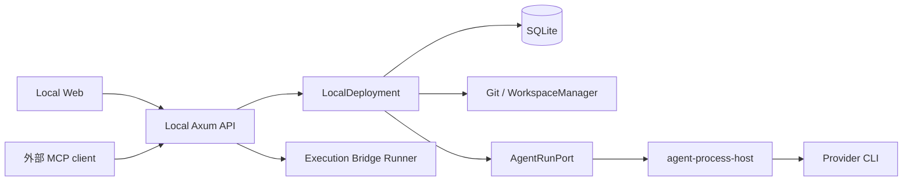

# システム境界と起動順序

LVK は、作業要求を管理する画面と、実際のファイル・Git・coding agent を動かすホストを組み合わせる。ローカルサーバーの `DeploymentImpl` は現在 `LocalDeployment` に固定されている。上流 Cloud / relay Remote Access は削除済みで、現在の Rust workspace に独立 Remote サーバーはない。[型の結線](../../crates/server/src/lib.rs#L1-L8)、[workspace 境界](../../Cargo.toml#L1-L36)

## 責任の配置

| 境界 | 所有する責任 |
| --- | --- |
| `server` | HTTP/WS の入力検証、製品操作、Workflow と Repository Memory の接続 |
| `server-access` | 配置別の認証、設定切替、メンバーとWebセッション、継続接続の失効 |
| `deployment` / `local-deployment` | 共通サービスの要求面と、ローカルの DB・実行・Git・preview の組み立て |
| `executors` / process host | provider 固有通信と、実行・監査の仕組み |
| `workflow` / server runtime | グラフの純粋な検証・計画と、永続状態・外部効果を伴う実行 |
| local Board API | SQLite 上の Project・Issue と関連情報。Web と stdio MCP へ異なる応答契約を提供 |
| Web の shell / `web-core` | 実行環境ごとの接続設定と共有製品画面 |

サービスの結線は [LocalDeployment](../../crates/local-deployment/src/lib.rs#L57-L89)と [Deployment trait](../../crates/deployment/src/lib.rs)が入口になる。Workspace の「container」はこのサービス上の作業環境を指す。ファイル所有権と Git の隔離は [Workspace](../concepts/workspace.md)で確認する。

## 永続化は一つではない

ローカル DB は asset directory の `db.v2.sqlite` を開き、SQLx migration を適用する。通常 pool は DELETE journal と 5 秒の busy timeout を使う。[DB 初期化](../../crates/db/src/lib.rs#L254-L268)、[timeout の理由](../../crates/db/src/lib.rs#L12-L15)

Board の Web は `/api/local`、stdio MCP は `/api/board` を使い、同じローカルデータを読む。旧名 `local_remote` や `remote-types.ts` は Cloud backend の存在を意味しない。[router](../../crates/server/src/routes/mod.rs#L44-L86) と [Web と同期](web-and-sync.md)で応答・再取得の契約を確認する。

Git の作業木、Native Audit、Repository Memory は SQLite と別の永続状態を持つ。復旧で DB の状態だけを正しいと決めず、[実行ホスト](agent-runtime.md)や [記憶の統合状態](../concepts/repository-memory.md)の証拠も確認する。

新しい [単一サーバーコンテナー](../operations/server-container.md)は、この local application を Linux サーバーで動かす配布形態である。PostgreSQL / Electric / relay に依存しない。backend の認証と nginx の HTTPS ingress・preview origin、実行環境と永続 volume の境界は同ページに置く。[配布の適用範囲](../../docs/self-hosting/server-container.mdx#what-the-image-contains)

standalone と embedded は共通の `Access` を組み立て、main router 全体と独立 preview listener に認証層を適用する。Origin guard だけを認証境界とは扱わない。配置・設定・失効の契約は [サーバー認証](../concepts/server-access.md)、preview の別 origin への委譲は [検査経路](../operations/workspace-inspection.md#preview-と開発サーバー)に置く。[main の配線](../../crates/server/src/main.rs#L215-L239)、[embedded](../../crates/server/src/startup.rs#L65-L72)

## 起動時は内側の所有者から回復する

standalone の `main.rs` と Tauri が使う `startup.rs` の両方に回復経路がある。

1. Deployment を構築し、実際の provider host の所有・接続を回復する。
2. 中断した bootstrap を fence してから、耐久化された direct command を再処理する。
3. Setup launch gate を照合する。
4. orchestration の outbox/inbox/lease、続いて Workflow を照合する。
5. 最後に OpenWiki の製品回復 monitor を開始する。

この順序は、複数の回復主体が同じ実行を進めることを避けるためにコードで明示されている。古い ExecutionProcess の孤児処理を新しい AgentRun へ流用すると、生きたプロセスを誤判定し得る。[standalone](../../crates/server/src/main.rs#L87-L137)、[embedded](../../crates/server/src/startup.rs#L170-L225)

Deployment の構築中には、DB 初期化後に既存の製品実行記録から [Workspace の用途](../concepts/workspace.md#操作用途と実行所有者)を backfill する。[呼出し](../../crates/local-deployment/src/lib.rs#L155-L156)。standalone は bootstrap fence に続いて中断した Integration preparation も fence し、OpenWiki monitor の次に [正式 Integration](../concepts/formal-integration.md) の monitor を開始する。一方、現行 embedded の対応箇所にはこの二つの Integration 呼出しがない。両起動経路で正式統合の自動進行が同じと仮定せず、desktop 対応を変更する際に確認する。[standalone の追加処理](../../crates/server/src/main.rs#L87-L137)、[embedded の現行配線](../../crates/server/src/startup.rs#L170-L225)

standalone は main と preview proxy に別 listener を作り、`BACKEND_PORT`、次に `PORT`、未指定なら OS の空き port を使う。既定 host は `127.0.0.1`。embedded の `start()` は `localhost:0` を使い、hostname と IPv6 接続の不一致を避ける理由が記録されている。[standalone listener](../../crates/server/src/main.rs#L146-L171)、[embedded listener](../../crates/server/src/startup.rs#L107-L142)

## 境界を変更するとき

API 型は Rust から TypeScript へ生成するため、Rust と Web の変更を一組として評価する。Board 型も server の生成器で扱う。通常の server 検証は Tauri を除外するため、desktop の検証済みとは読み替えない。[型生成の入口](../../crates/server/src/bin/generate_types.rs#L642-L663)、[開発・検証](../operations/development.md)

外部からの接続は一種類ではない。[認証付き MCP](../integrations/remote-access.md)は既存 LVK 操作を公開し、[Execution Bridge](../concepts/shared-resource-coordination.md)は資源束を所有したまま明示登録 Runner で処理を実行する。両者は削除済み relay と独立している。[Astra](../concepts/project-chat.md)もプロジェクト会話の窓口であり、AgentRun や Workflow の別 scheduler ではない。
