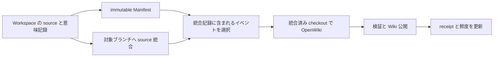

# Change Manifest・Run完了とWikiの責務

開発中の文脈は Codex / Claude Code の Session が扱う。LVK は独自の Workspace Memory、専用の no-change 検証記録、commit reminder を廃止し、変更の意味をファイル Change Manifest、統合済み知識を canonical OpenWiki に分ける。source/tests/configuration を現行動作の権威とし、Manifest は意図・理由を調べる参照データとして扱う。新しい要約・Session引継ぎ基盤は作らない。[host指示](../../crates/utils/src/repository_memory.rs)

## Session・Manifest・統合済みWiki

Worktree Workspaceの通常の成功 coding Run は Wiki の有効／無効と独立して source を確定し、Manifest をその SHA に結び付ける。source が既に全て commit 済みなら HEAD を再利用し、余分な commit や amend をしない。no-change では空の Manifest や commit を作らない。失敗・取消・REVIEW・制御・自動マージ担当・Design Arena 等を一律に自動 commit する規則ではなく、既存の実行目的と正常終了条件を維持する。[完了処理](../../crates/services/src/services/repository_memory.rs)・[host適用条件](../../crates/local-deployment/src/agent_run_port.rs)

Issue化・要件更新・既存Sessionへの追加指示では、上位AIが確認できた人間の目的・動機・制約、判断と理由、見送り案・未決点を渡す。Issue本文の編集だけでは既存Sessionへの追加指示にならない。coding host は直接会話も含めて人間の意図と自分の実装判断を区別し semantic draft に残す。承認を技術的理由の代わりにせず、不明な理由は創作しない。固定書式の空欄埋めや些細な変更の長文説明は要求しない。[上位AIの受渡し](../../skills/lvk-orchestration/references/execution.md)・[coding host](../../crates/utils/src/repository_memory.rs)

[Card context の .llm-wiki](card-context-and-llm-wiki.md) は従来の作業ブランチ内の知識機能である。導入時の判断は「既存機能と利用者の編集を保持し、canonical OpenWiki を別名と単一 writer で追加する」だった。これは導入時の履歴であり、現行版は旧 `.llm-wiki` の生成・読取 UI・自動注入を終了している。既存ファイルや手作業のメモは残す。[終了後の扱いと移行境界](card-context-and-llm-wiki.md#旧-llm-wiki-からの移行境界)を参照する。[現行の旧指示filter](../../crates/executors/src/legacy_wiki.rs)

### Bootstrap の索引・レポートは記憶の正本ではない

初期生成も同じ repository shared storage を再利用する。機械抽出した文書索引は `persistent/knowledge/document-inventories/<run-id>/` の manifest と chunk、検証済み Review / Refine は `bootstrap-reports/<run-id>/review.json` / `refine.json` に保存する。前者は共通の探索入力、後者はその run の検証成果物であり、source の Change Manifest や公開 Wiki 本文に混ぜない。[保存と読取](../../crates/utils/src/repository_memory.rs)

共有フォルダーに置いただけで OS レベルの不変性を得るわけではない。索引の identity と digest は host の Workflow 入力、report の identity と digest は検証済み node output に固定し、工程境界で照合する。Sessionの私的文脈を Reviewer へ引き継ぐ仕組みでもない。具体的な読取・独立性・公開前の検証は [OpenWiki 保守](../operations/openwiki-maintenance.md)を参照する。[host 所有の入力](../../crates/server/src/workflow_runtime/bootstrap.rs#L177-L220)、[report の identity と digest](../../crates/services/src/services/openwiki/bootstrap/reports.rs)、[再検証](../../crates/services/src/services/openwiki/bootstrap/reports.rs)

保守開始元の Project は、保守 Workspace をどの Board の Issue に結ぶかという文脈である。Wiki の設定・writer lock・source checkpoint は引き続き Repo 単位であり、Project ごとに別の正本を作るものではない。明示 Project の検証と未指定時の互換動作は [開始元 Project と保守 Issue](../operations/openwiki-maintenance.md#開始元-project-と保守-issue)を参照する。[共通受付](../../crates/server/src/routes/openwiki.rs#L235-L282)・[紐付けの境界](../../crates/server/src/routes/openwiki/project_context.rs#L6-L43)

## Change Manifest は変更理由を運ぶイベント

Coding host が書くのは goal、summary、振る舞い・構造・不変条件への影響、判断、テスト結果などの **semantic draft**。LVK が run 開始時に Repo/Workspace/run ID と Git base を固定し、完了時に Git から changed paths と source commit を求めて **Change Manifest** にする。モデルが書いた任意の revision や membership を採用しない。[固定 context](../../crates/services/src/services/repository_memory.rs)、[Manifest 組み立て](../../crates/services/src/services/repository_memory.rs)

イベント ID は coding run ID で、一イベント一 JSON の outbox として公開される。イベント本体と、後から更新可能な receipt/state は別である。同じイベントを再処理して新しい source commit を無制限に作る設計ではない。[イベント保存](../../crates/utils/src/repository_memory.rs)、[完了の再入](../../crates/services/src/services/repository_memory.rs)、[不変イベントと再送](../../crates/utils/src/repository_memory.rs)

source に変更がなければ無変更 checkpoint で終わる。変更があって draft が missing / invalid なら、元 draft を保持し、意図・理由・テスト結果が不明であることを明記した Git-only checkpoint を作る。これは意味記録を捏造せず、次の coding host が draft 修復前でも起動できるための縮退である。I/O 障害、凍結 publication 不整合、Git / Wiki guard は引き続き失敗させる。制御用 run など `finalize_source=false` の場合も変更を自動 commit しない。[分岐と検証](../../crates/services/src/services/repository_memory.rs)

Git 変更前には Manifest と staged tree を固定した publication 記録を書く。復旧時は `LVK-Memory-Source` marker、親 commit、tree を照合する。後から追加された変更や書き換えた draft を前のタスクの結果として取り込まないための境界である。次の coding run を開始する前にも、同じ Workspace の前回成功 run の未完了公開を回復する。[公開と検証](../../crates/services/src/services/repository_memory.rs)、[次回起動前の回復](../../crates/services/src/services/repository_memory.rs)、[後続編集保持のテスト](../../crates/services/src/services/repository_memory.rs)

## Source 統合と Wiki 反映を分ける

通常 Workspace の `openwiki/` 変更は、commit 済み・未 commit・削除・rename を含めて完了/統合 guard が拒否する。ファイルを勝手に破棄して通す処理ではない。並行ブランチごとの派生 Wiki を merge すると Markdown、Claims、run state が競合するため、source を統合してから記憶を更新するという設計理由が記録されている。[guard](../../crates/services/src/services/repository_memory.rs)、[現行のsource guard](../../crates/services/src/services/repository_memory.rs)

既存の手動直接 merge は squash を使うため、元 commit の祖先関係だけではイベントの所属を再現できない。統合前に明示的な event ID 集合と before commit を保存し、統合結果を対応付ける。Wiki の処理対象は、対象ブランチへ統合済みと確認でき、成功 receipt がまだないイベントである。[統合準備](../../crates/services/src/services/repository_memory.rs)、[イベント選択](../../crates/services/src/services/repository_memory.rs)

[自動マージ](formal-integration.md)は、同じ専用会話でコード候補と有効なWiki更新を作り、code SHA・Wiki SHA・完成候補を別々に固定してhostへ公開要求する。検証実行と省略はcode SHAへ記録し、失敗をpassへ変換しない。公開後に選択source eventへのreceiptをinstance DBへ保存し、後処理の失敗は適用済みGit/Doneを巻き戻さない。旧step summaryからの統合Manifest生成や後続Wiki agentを前提にしない。[現行契約](../../crates/server/src/routes/integrations/conversation.rs)・[後処理](../../crates/server/src/routes/integrations/runtime.rs)

専用会話へ渡すMemoryは、受付時にsource祖先関係を確認した固定event IDsの公開記録だけを解決する。Repo/Workspace所属を検査し、不在はunavailableとして伝える。Sessionの私的文脈や後着eventを混ぜない。[公開Memory解決](../../crates/server/src/routes/integrations/runtime.rs#L73-L104)

公開イベント・新規pending・古いbacklog・main直接変更は、別のWiki WorkspaceやAgentを自動起動しない。起動時と5秒周期の回復は、保存済みBootstrapまたは予約済みAgentRunの所有者を回収する。自動マージでは同じ候補内でWikiを更新し、それ以外の更新・再同期・初回生成はUIまたは認可済みMCPの明示要求から開始する。未処理イベントは強制ackせず、明示保守の入力として保持する。[受付と回復](../../crates/server/src/routes/openwiki.rs#L170-L202)・[新規受付なしの回復](../../crates/server/src/routes/openwiki.rs#L522-L550)・[隔離回帰](../../crates/server/src/routes/openwiki/recovery_tests.rs#L65-L160)

## Sync の入力は統合済み source に結び付く凍結 snapshot

通常 Sync は、対象 Repo・maintenance Workspace・固定した source commit・target branch・選択 event ID を manifest に保存する。各 Change Manifest を個別の `chunk-NNNNNN.json` とし、manifest の `chunks` 配列には番号順の SHA-256 を格納する。保存先は共有領域の `knowledge/sync-inputs/<maintenance-workspace-id>/` である。これは mutable draft や現在の Memory を直接読ませ続ける仕組みではない。[入力の生成](../../crates/services/src/services/openwiki/sync_input.rs)、[保存先](../../crates/utils/src/repository_memory.rs)

host は manifest と全 chunk を順番に最後まで読むよう要求する。応答の切り詰めを読了と扱わず、必要なら範囲を分ける。Change Manifest の意図・判断・検証限界は調査の入口にし、現行動作は integrated checkout で確認する。可変 Workspace Memory の snapshot は作らない。空の event/chunk 配列だけで調査不要とは判定しない。manifest の scope が調査境界を固定する。`current_source` は既存 Wiki と凍結ソース全体の照合、`pending_changes` は統合 event の影響範囲、`since_commit` は指定 base を除く base..source の差分である。範囲限定 adoption は古い内容を再検証したと主張せず、`unverified_before` によって Current を抑制する。[読取と権威の契約](../../crates/services/src/services/openwiki/sync_input.rs)

公開前には、host state が持つ manifest digest、Repo/Workspace/source/target/events/scope の一致、全 chunk の digest を照合する。共有ファイル自体を OS が改変不能にするのではなく、host に固定した identity と digest で変化を検出する。移行前に開始済みで digest を持たない Sync だけは、immutable request に入力があるものとして互換経路を通る。凍結後の元draft変更は入力を変えない一方、別 Repo の入力・event 集合のずれ・chunk 改変は失敗する。[検証](../../crates/services/src/services/openwiki/sync_input.rs)、[凍結と改変のテスト](../../crates/services/src/services/openwiki/sync_input.rs)

## 並行性・receipt・失敗

通常 Workspace の source 完了は Workspace ごとの lock、Wiki の所有管理は Repo の lock、source/Wiki 公開は短い integration lock を使う。モデル実行中に integration lock を保持しない。これにより source 作業とイベント発行の並行性を残しながら、正本の公開を直列化する。[lock の責任](../../crates/utils/src/repository_memory.rs)

receipt の結果は Updated / NoOp / Failed。Failed はイベントを acknowledge 済みと扱わず、次回も対象に残る。成功時だけ対象 source、Wiki commit、最終成功時刻を保存する。Wiki が無変更でも検証済みの成功となり得る。[選択](../../crates/services/src/services/repository_memory.rs)、[結果記録](../../crates/server/src/routes/openwiki.rs)、[Failed→NoOp テスト](../../crates/services/src/services/repository_memory.rs)

新しい Wiki 公開は、対象ブランチと maintenance HEAD が固定 source に一致することを検査し、source が進んでいれば拒否する。Wiki 失敗は既に成功した source 統合を取り消す意味ではない。初期化と再試行、終了証明、公開 checkpoint の詳しい手順は [OpenWiki 保守](../operations/openwiki-maintenance.md) に置く。[公開検証](../../crates/services/src/services/openwiki.rs)、[公開と回復の実装](../../crates/services/src/services/openwiki.rs)

通常 coding run の Wiki 鮮度探索では、別 Workspace の壊れた event などを診断し、Wiki 状態を Error として作業開始を継続できる。これは選択 event の厳密な公開検証を省略する許可ではない。[起動時の縮退](../../crates/services/src/services/repository_memory.rs)

読み取りの observer はDB層の `read_only_configured_for_repository` とファイル層の `read_only_at_persistent` を使い、未設定と不存在を区別してディレクトリや state を作らない。writer 用 `existing_for_repository` は設定済み storage を開く際に新しいサブディレクトリを用意できるため、純粋な閲覧経路には使わない。[reader と writer](../../crates/utils/src/repository_memory.rs)。

Current は単なる「ファイルがある」ではない。有効化、Wiki 存在、成功履歴、pending の有無、source の一致を踏まえて判定する。Error/Stale などの状態は保持されるため、古い snapshot を読んだ agent が常に最新とみなす根拠にはならない。[派生状態](../../crates/utils/src/repository_memory.rs)

外部 MCP でも、その request の受付、その実行の確定結果、現在の repository 鮮度を別々に観測する。過去の実行が `wiki_complete:true` でも、その後に source が進めば現在の Wiki は stale になり得る。MCP operation receipt と、この節の event 単位の reconciliation receipt は別物である。開始・再送・読戻しは [MCP から既存 Wiki を同期する](../operations/openwiki-maintenance.md#mcp-から既存-wiki-を同期する)を参照する。[応答の分離](../../crates/server/src/remote_mcp/repository_wiki.rs#L135-L211)・[実行結果の判定](../../crates/server/src/remote_mcp/repository_wiki.rs#L286-L305)

## 成果の寿命と保守 Workspace の寿命

Wiki の成功 receipt・canonical branch と、生成された保守 Workspace の存続は別の契約である。Sync は公開判定から owner 固有の成功結果（no-op を含む）を保存し、repository の active owner を解除する。process が収束し用途を解除できた新規内部生成 Workspace は、[一度限りの自動 archive](workspace.md#生成された専用-workspace-の自動-archive)の対象になり得る。archive の拒否や削除失敗で成功 receipt を取り消さず、archive 済みであることから Current や公開成功を逆算しない。[結果と state](../../crates/server/src/routes/openwiki.rs#L600-L705)・[解除と後処理](../../crates/server/src/routes/openwiki.rs#L894-L911)

## 変更を検討する際の一次資料

歴史的な導入仕様は意図・不変条件を、実装checkpointは判断と過去の検証結果を記録していた。ここへ移した履歴を現行sourceの代用にしない。記録されたテスト成功を現在の環境の実行結果とは扱わない。とくに source commit と outbox の間、squash 統合と記録の間、Wiki 公開と receipt の間の再起動窓を変更する場合は、対応する回復テストと現行実装を一緒に確認する。

## sourceを変更しない新Runの報告

no-change Run は `verification-starts` / `verifications` の専用記録を生成せず、専用 MCP `get_workspace_verification` / `get_workspace_verification_test` も提供しない。通常の `list_workspace_runs` → `get_execution(section="final_response")` で会話・最終報告を読む。Manifest の test 欄は実施／未実施・結果・理由の短い要約で、詳細ログや大量の証拠データの正本ではない。自動マージ自身の code SHA・command・exit・省略理由は既存 integration / execution の DB 記録が所有し、Manifest の自己申告で合格にしない。[通常読取](../../crates/server/src/remote_mcp/runtime_read.rs)・[統合検証](../../crates/server/src/routes/integrations/conversation.rs)

## 任意のコミット本文併記

`manifest_in_commit_body` は既定 OFF。ON の場合、LVK が通常Run完了で作る source commit の本文に、目的・完全なsummary・変更・不変条件・判断と理由・却下案・未決点・検証要約を人間可読に併記する。短さのために意図を切らず、空欄とsubjectとの重複だけを省く。検証は有効なsummaryを優先し、空ならcommand、それも空なら結果だけを表示する。既存の短いsubjectと `LVK-Memory-Source` marker は維持し、自己SHA・JSON全文・詳細ログ・会話全文は追加しない。[整形](../../crates/utils/src/repository_memory.rs#L170-L264)

本文は push・clone で共有される。設定は通常 LVK source commit だけを対象にし、既存commit・自動マージmerge/修復・Wiki・直接squashまでの本文保証やamendを行わない。ファイルManifestはON/OFF両方で正本のまま残し、本文から復元するparserは作らない。最初のpublication固定時に整形済みmessageを保存し、retryは現在設定やmutable draftで作り直さない。旧publicationにmessageがなければ従来のsubject＋markerで回復する。[固定と再試行](../../crates/services/src/services/repository_memory.rs#L275-L365)・[設定](../../crates/services/src/services/config/versions/v9.rs)

## 運用状態のDB集約と一度限りの開発移行

instance DB の `repository_wiki_state`、`repository_wiki_receipts`、`repository_wiki_publications`、`repository_integrations` が可変運用状態の正本である。通常Syncはreceipt・state・Workspace実行結果、自動マージはreceipt・state・integration結果を同じDB transactionで確定する。Gitとは一括transactionではないため、操作前のintentと実SHA・parent/tree・markerによる回復は維持する。[DB層](../../crates/db/src/models/repository_state.rs)・[Sync確定](../../crates/server/src/routes/openwiki.rs#L604-L629)・[統合確定](../../crates/server/src/routes/integrations/runtime.rs#L503-L540)

Manifest（events）、会話、固定sync-inputs、source-publications、Run identity/完了checkpoint、setup原本/復元journal、Bootstrap索引/reportは別責務のファイルとして保持する。運用状態をDBへ寄せることを理由にknowledge全体を削除しない。read-only observerはディレクトリ/stateを作らず、DBの設定行がなければ未設定として返す。設定済みなのにartifactディレクトリが欠けている場合はエラーになる。[DB opener](../../crates/db/src/models/repository_state.rs#L32-L77)

一度限りの開発移行は履歴上の作業であり、LOCAL-336で移行CLI・importer・旧運用JSON decoder・未移行互換guard・専用runbookを撤去した。現行版で旧ファイルを取り込むコマンドは提供しない。前進SQL migrationと通常DB modelは保持する。[現行起動入口](../../crates/server/src/main.rs#L42-L70)・[運用modelと通常fixture](../../crates/db/src/models/repository_state.rs)

旧 `knowledge/state.json`、`integrations/*.json`、`publications/*.json`、`receipts/*.json`、廃止済みWorkspace Memory・専用検証記録の物理削除はコード撤去と別である。残存対象と現役artifactを個別に確認し、対象を明示した許可を得てから扱う。knowledge全体、backup、現役のGit復旧情報を一括削除しない。旧binaryへの復帰を、schema migration済みDBで安全と推定しない。[切替と復旧の手順](../../deploy/developer/switch/README.md)

この保守ではlive DB・旧共有ファイル・backup・releaseを変更せず、devのビルド・停止・再起動・切替も実施していない。実装ManifestのDB 2件・utils 14件・server全targetコンパイル成功はsource SHAに結び付く既存記録であり、今回の再実行結果ではない。

## 文書方針と意味記録の境界

共通 host prompt は、source・tests・configuration による現行動作の検証と、repository 固有の文書保守方針への従属を別々に要求する。保守される正規文書は説明とリンクを残せるが、移行対象の文書は必要な知識を Wiki 本文へ保存する。共通実装自体が全 repository に `docs/` の削除を命じるわけではない。[共通 host の文書契約](../../crates/services/src/services/openwiki.rs#L200-L216)

Change Manifest の goal・判断・却下案は意図を調べる入口であり、統合済みでない私的文脈の案を製品契約へ昇格しない。理由は source と利用可能な Manifest で裏付け、Design Note は補助情報として扱う。現在の動作、記録された意図、過去の判断を区別し、確認できない理由は不明のまま残す。Bootstrap の全役割と通常 Sync への適用、運用手順の保存責任は [文書方針の継承](../operations/openwiki-maintenance.md#文書方針の継承と移行の判定)に置く。[Sync の調査契約](../../crates/services/src/services/openwiki.rs#L192-L216)・[Bootstrap の証拠契約](../../crates/services/src/services/openwiki/bootstrap.rs#L398-L406)

## 自動マージの setup 原本は公開記憶と別の証拠

repository shared storage の `integration-wiki-setups/<integration UUID>.json` は、begin前の原本とowner/code identity、復元phase、過去と最終Wiki SHAを保持する。公開ManifestやWiki本文の代わりではなく、host receiptの原本digestとcode treeに照合する復元用journalである。廃止済みWorkspace MemoryやBootstrap索引をこの原本として流用しない。準備・writer収束・限定復元の順序と再開時の拒否境界は [自動マージ](formal-integration.md#begin-前の原本準備と-host-の限定復元)を参照する。[保存先](../../crates/utils/src/repository_memory.rs#L781-L805)・[identityと原本検証](../../crates/services/src/services/openwiki/setup/integration.rs#L259-L334)

## リポジトリ設定ファイルと生成物の所有

LOCAL-344は利用者の決定として、執筆指示 `openwiki/INSTRUCTIONS.md` と探索除外 `.openwikiignore` を同じ操作体系で実ファイルへ全文保存し、保存・削除・再構築を分ける。保存は次回以降の入力変更であり、生成や同期を開始しない。共通既定はリセット元に限り、設定差分の階層合成は行わない。[設定保存](../../crates/server/src/routes/openwiki/management.rs)

削除・置換する生成集合は既存manifest、生成frontmatter、管理索引・メタデータから識別し、openwiki全体を消さない。設定と不明な人間管理文書を保持し、通常writerによる人間文書の本文変更や生成manifestへの取り込みも公開前に拒否する。対象文書が本家の生成対象になる場合は、保存済みignoreで除外してから再試行する。[生成集合](../../crates/services/src/services/openwiki/management.rs)・[公開前検査](../../crates/services/src/services/openwiki.rs)

削除成功はDBのsource/Wiki鮮度とcheckpointを未生成へ戻し、generation_suppressedで通常Syncと自動マージからの再生成を抑止する。設定保存・削除のfile_operationは既存専用Workspaceと公開checkpointを使い、結果とstateを同一DB transactionで確定する。再構築は開始時公開先SHAをrebuild_referenceとして固定し、旧Wikiの知識を現在のコード・テスト・設定へ照合する。コードだけでは失われた運用知識や理由を完全復元できないという利用者の意図を保ち、旧記述を無条件に継承しない。[操作と復旧手順](../operations/openwiki-maintenance.md)

### 直接フォルダの除外

DirectFolderは古いRepo行が残っていてもbegin・前回成功Runの回収・source準備から除外する。LVKの自動commit、Manifest、Repo Wiki管理を配下Gitの発見だけで有効化しない。結果は通常会話で確認し、非Git専用Manifestを追加しない。Repoのshared保存先は元Repoの識別を保ち、同名衝突用のworktree配置名へ移動しない。
