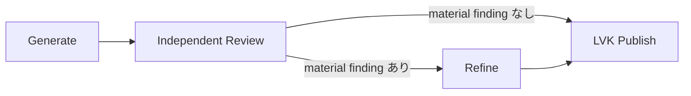

# OpenWiki の初期生成・同期・回復

OpenWiki maintenance は、統合済みソースから canonical Wiki を更新する専用作業である。通常の coding Workspace が生成する Change Manifest、Source checkpoint、receipt の意味は [Repository memory](../concepts/repository-memory.md) に集約する。ここでは、その入力を Wiki に反映する実行と回復を扱う。

## 開始条件と通常 Sync

単独保守の新規受付は、UIまたは認可済みMCPからの明示要求に限定する。公開イベント、新規pending、既存backlog、main直接変更、再起動・定期回復から別のWiki Workspace/Agentを自動生成しない。自動マージはコード検証後の同じ候補内で更新する。[受付](../../crates/server/src/routes/openwiki.rs#L170-L202)・[回復](../../crates/server/src/routes/openwiki.rs#L522-L550)

5秒monitorは保存済みBootstrap/AgentRunの回収、公開・失敗cleanupのために残る。未処理イベントを強制ackして隠す処理はなく、Manifest・凍結入力は明示保守と既存ownerのために保持する。[monitor](../../crates/server/src/routes/openwiki.rs#L826-L843)

Repository settings で有効化し、統合先の **local branch** と出力言語を選ぶ。開始処理は未解決の source integration を拒否し、未処理 event の統合 commit が選択 branch に入っていることを確認する。remote branch 自体を公開先にはできない。必要な source が未取得なら model を開始せずエラーにする。[開始前の検証](../../crates/server/src/routes/openwiki.rs)

初期生成かどうかは、固定した統合済み source commit に `openwiki/INSTRUCTIONS.md` 以外の `openwiki/` 追跡ファイルがあるかで判定する。`index.md` が欠けた部分的な import も既存 Wiki として保持し、dirty checkout にだけあるファイルは判定に使わない。Repository settings の入口では生成前なら Bootstrap、既存Wikiがあれば通常 Sync を選ぶ。外部 MCP の同期入口は既存Wiki不在を拒否し、暗黙の Bootstrap を開始しない。通常 Sync は一つの Codex Session / AgentRun による reconciliation であり、Bootstrap の独立 Review を毎回実行するものではない。[存在判定](../../crates/services/src/services/openwiki.rs#L300-L303)・[部分importとdirty fileの回帰](../../crates/services/src/services/openwiki.rs#L517-L533)・[分岐](../../crates/server/src/routes/openwiki.rs#L268-L285)

開始時の存在判定と公開時の完成条件は異なる。公開候補には finalised `openwiki/index.md` が必要であり、部分importを既存Wikiとして受け入れることは、そのまま公開可能という意味ではない。[公開条件](../../crates/services/src/services/openwiki.rs#L333-L346)

実行環境には pinned OpenWiki と Node.js 22.22.0 以上、既存 Codex 認証を用意する。保存・開始・状態確認は [設定から保守を開始する](#設定から保守を開始する)に従う。LVK の version 検査は CLI の help banner を読み、固定版との完全一致を要求する。--version が exit 0 になるだけでは互換性の確認にならない。[配布pin](../../assets/openwiki-version)・[version 検査](../../crates/services/src/services/openwiki.rs)

LVK の準備処理は public Codex integration を --force なしで準備する。変更された user 設定を上書きせず conflict とする方針が code comment に記録されている。maintenance thread は public MCP の `openwiki mcp --host codex` を必須として設定し、turn / Goal 開始前に実際の lifecycle 6tool と読取4tool の catalog を確認する。[準備境界](../../crates/services/src/services/openwiki.rs)・[thread 設定](../../crates/executors/src/executors/codex.rs)・[起動前確認](../integrations/agent-providers.md#coding-agent--外部-mcp-server)

Codex の TOML editor が project trust table を追加すると、OpenWiki の閉じ marker だけがファイル末尾へ移る場合がある。LVK の準備処理は installer の前にこの限定されたずれを修復する。単一 marker pair、既定の MCP command/args、同じ解析済み TOML 値を確認し、利用者の設定値は変更しない。custom MCP 値・曖昧な marker は修復せず installer の conflict として残す。[原因と修復条件](../../crates/services/src/services/openwiki/codex_config.rs#L1-L48)

修復は native settings lock 下で symlink・hardlink・2 MiB超の非通常入力を拒否し、permission を維持した一時ファイルの同期後、元内容が変わっていないことを再確認して置換する。これは LVK が maintenance 起動前に行う準備であり、writer が設定ファイルを直接修正する手順ではない。[ファイル境界](../../crates/services/src/services/openwiki/codex_config.rs#L50-L92)、[再現・冪等性・拒否テスト](../../crates/services/src/services/openwiki/codex_config.rs#L95-L156)

開始時は同じ Git storage の自動マージが succeeded / blocked / failed / cancelled 以外の段階（preparing / integrating / validating / cancelling / recovery_requiredを含む）にあれば拒否する。source が見えていても、その公開結果や semantic outbox が未確定の間に Wiki を先へ進めない。[自動マージとの境界](../../crates/server/src/routes/openwiki.rs)

両経路とも [実行専用 Workspace](../concepts/workspace.md#操作用途と実行所有者)を作り、起動前に owner を保存する。通常 Sync は選択 event のChange Manifest凍結入力を作り、その digest/source/event 集合を host state に保存してから AgentRun を予約・所有者へ bind する。[準備と起動の順序](../../crates/server/src/routes/openwiki.rs)、[Sync の入力と予約](../../crates/server/src/routes/openwiki.rs)。全 manifest/chunk の読取、Manifestの権威、空入力の意味は [凍結入力の契約](../concepts/repository-memory.md#sync-の入力は統合済み-source-に結び付く凍結-snapshot)を参照する。

明示 Sync の対象は現在の統合ソース全体、または指定 SHA からの範囲である。SHA は選択 branch の祖先である必要があり、初期生成に開始 SHA は指定できない。範囲外 event の扱いと未確認領域は [Repository memory](../concepts/repository-memory.md) の契約に従う。[scope 解決](../../crates/services/src/services/openwiki/sync_scope.rs)

準備 future は Workspace lifecycle barrier 内で archive 状態を再確認して RAII 予約を取得する。installer 待機など AgentRun/Workflow がまだない期間も [手動 archive の busy 判定](../concepts/workspace.md#archive削除期限-cleanup)で保護し、future の完了・error・cancelで解放する。AgentRun終端後も repository state の active_run_id/bootstrap が残る host finalizing は archive 不可である。単に usage ラベルが execution_only という理由で永久に拒否する方式ではない。[準備の寿命](../../crates/server/src/routes/openwiki/preparation.rs#L1-L41)・[呼出位置](../../crates/server/src/routes/openwiki.rs#L384-L413)・[未完了所有の照合](../../crates/server/src/routes/workspaces/archive.rs#L45-L124)

### 保守準備と追跡ignoreを分ける

Wiki設定保存はRepo外の共有storageだけを準備し、公開先checkoutに共有リンクや `.lvk/.gitignore` を生成しない。専用保守Workspaceは永続execution_ownerのOPENWIKI_BOOTSTRAP / OPENWIKI_SYNCを使い、新規作成と再作成の両方で `.lvk/.gitignore` を変更しない共有準備を選ぶ。runtimeの `/.lvk/shared/`・`/.lvk/attachments/` だけをGit common info/excludeへ冪等追記するため、兄弟worktreeにも適用される。通常Workspaceの `.lvk/.gitignore` 集約契約は維持する。[設定保存](../../crates/server/src/routes/openwiki.rs)・[owner経由の準備](../../crates/local-deployment/src/container.rs)・[限定除外](../../crates/workspace-manager/src/shared_resources.rs)

これはclean判定や公開allowlistを緩める処理ではない。source、integration-validation設定、既存ignoreの変更は公開拒否のままであり、任意の否定ignoreでnative Git statusにruntimeが見えても、人間設定の上書きや `.lvk/` 全体の除外で回避しない。リンク衝突・symlink/hardlink拒否と元のexclude内容を保護する。変更時はworkspace-managerのowner別条件とservicesの `maintenance_runtime_exclusion_preserves_initial_and_sync_publication_guards` を入口にする。[公開guardと回帰](../../crates/services/src/services/openwiki.rs)

## 自動マージ担当が更新する場合

通常SyncやBootstrapとは別に、自動マージではコード検証後の同じ候補branchでcanonical `openwiki/` を更新し、Wikiだけを別commitにする。コード検証SHAとWiki/公開SHAを分けて記録し、finish完了前やWiki失敗時は公開しない。専用Wiki Issueや別Workspaceへ分岐しない。[公開要求とSHAの契約](../concepts/formal-integration.md)・[担当promptと公開guard](../../crates/server/src/routes/integrations/runtime.rs)。

自動マージの手順は次の順序を守る。

1. cleanなcode候補SHAで必要な検証・理由付き省略を記録する。
2. 最初のbeginより前に `integration_action prepare_wiki` へそのSHAを渡し、原本journalとdigestの保存成功を確認する。begin-noopや再開でも後付けを許さない。
3. 同じ候補branchで正規begin → plan/page → finishを完了し、Wikiのみ別commitにする。source・README・ユーザーINSTRUCTIONSを変更せず、生成AGENTS/CLAUDE差分は未stageで残す。
4. code_commit、wiki_commit、expected_commitを分離して正式publish要求を保存し、全子processを収束させ担当Runを終了する。受付はGit公開の成功ではない。
5. hostが担当/target writerの終了とNative Audit完了proofを確認し、正確な既知setup差分だけをjournalから限定復元してclean検査・既存公開guardへ進む。

[prepareと証拠](../../crates/server/src/routes/integrations/conversation.rs#L526-L713)・[公開の順序](../../crates/server/src/routes/integrations/runtime.rs#L319-L410)・[setup限定検査](../../crates/services/src/services/openwiki/setup/integration.rs#L105-L258)

原本はintegration/repository/storage/Session/Workspace/root/code SHAに束縛される。journalの欠損・改変、未知のdirtyや管理節内外の後編集、index/HEAD不一致、symlink/hardlinkを推測で復元しない。standalone/bootstrapの既存setup journalと自動マージ専用journalを混同しない。自動マージは各Wiki commitのsourceとユーザーINSTRUCTIONS不変も検査する。[identityと原本](../../crates/services/src/services/openwiki/setup/integration.rs#L259-L334)・[事前検査](../../crates/services/src/services/openwiki/setup.rs)

復元済み候補で新writer phaseを始める場合だけ、新request IDのprepareを成功させる。同じ原本と元code SHA、過去Wiki SHA/phase baseを保持し、再snapshotしない。最終SHA固定後のPrepared crash窓やRestoringでprepareが拒否されたらbeginせず、同じ最終SHAを再publishしてhostの復元収束へ渡す。欠損journalを手動作成したりAGENTSをstage/restoreして拒否を回避しない。[phase再開](../../crates/services/src/services/openwiki/setup/integration.rs#L35-L65)・[詳しい自動マージ契約](../concepts/formal-integration.md#begin-前の原本準備と-host-の限定復元)

## 開始元 Project と保守 Issue

保守の所有単位は Repo のままだが、Project 設定からの Initialize / Sync は選択中の `project_id` を任意フィールドとして共通受付へ渡す。外部 MCP Sync も認可済みの Project を渡す。これにより、複数 Board が同じ Repo を使う場合でも開始元を失わず、その Project の通常 Issue と保守 Workspace を関連付けられる。[UI の引継ぎ](../../packages/web-core/src/shared/dialogs/settings/settings/ReposSettingsSection.tsx#L570-L577)・[共通フォーム](../../packages/web-core/src/shared/dialogs/settings/settings/RepositoryMemorySettings.tsx#L105-L127)・[MCP adapter](../../crates/server/src/remote_mcp/repository_wiki.rs#L255-L270)

明示 Project は実在し、`project_associated_repository_ids` に対象 Repo が含まれる必要がある。この集合は新規作成用Gitプリセットと既存Issue/Worktree Workspaceの実Repoを合わせる。保存済みProjectRepoDefaultsがあれば空配列も含めて作成プリセットとして優先し、なければproject_reposを使う。したがって開発 Card がまだない Project でも Git Repoプリセットで関連を証明できる。directory 方式の defaults に残った Repo 値や、削除済み Project の Scratch だけでは認めない。受付時に加え、repository lock や version 検査の待機中に設定が変わり得るため紐付け直前にも検証する。[存在と再検証](../../crates/server/src/routes/openwiki/project_context.rs#L6-L43)・[関連集合](../../crates/server/src/routes/local_remote.rs#L3390-L3413)・[既存関連](../../crates/server/src/routes/integrations/mod.rs#L130-L150)

| 開始文脈 | 保守 Issue の扱い |
| --- | --- |
| 有効な明示 Project | その Project を選ぶ。共有 Repo の他候補へ推測で振り分けない |
| Repo 単独設定・旧 client の明示 request（Project未指定） | `project_repos` と既存 Issue/Workspace の Repo 関連から Board が一つだけなら作る。候補ゼロ・複数なら Issue なしで継続する |
| 選ばれた Project に可視 status がない | Issue なしで継続する。可視 status があれば `sort_order,id` 順の先頭を使う |
| Workspace に既存 link がある | 付け替えない |

Issue 採番と link 作成は `BEGIN IMMEDIATE` transaction 内で行い、その前後で既存 link を再確認する。過去 Workspace の起動時補完は明示 Project を持たない一意 Board の規則を保ち、定期 release monitor は利用者が解除した link を再生成しない。**すべての保守 Workspace に Issue があるという保証ではない**。これは Repo 単独・共有 Repo の既存利用を保つ互換契約として運用文書にも記録されている。[link と transaction](../../crates/services/src/services/workspace_usage/lifecycle.rs#L37-L127)・[過去補完](../../crates/services/src/services/workspace_usage.rs#L135-L149)・[運用契約](../../crates/services/src/services/workspace_usage/lifecycle.rs)

削除済み・無関連の明示 Project はエラーとなる。Project の存在と **Configure project working location** の保存済み Repo を確認する。Issue が必要なのに可視 status がない場合は、Project 設定で追加または表示してから後の実行を開始する。MCP はこれに加えて接続の Project 認可を保ち、共通受付後のエラーを安全な再実行と即断しない。[検証エラー](../../crates/server/src/routes/openwiki/project_context.rs#L6-L24)・[MCP の不確実な受付](#不確実な結果と検証の境界)

変更時は [in-memory DB fixture](../../crates/server/src/routes/openwiki/project_context.rs#L45-L270)を入口に、Bootstrap/Sync の両 owner、defaults のみの関連、削除・無関係 Project、共有 Repo、指定なし、status なし、Session 作成までを確認する。[UI fixture](../../packages/web-core/src/shared/dialogs/settings/settings/RepositoryMemorySettings.test.tsx#L86-L107)は Initialize/Sync の Project 伝播と未指定 request、[MCP fixture](../../crates/server/src/remote_mcp/launch_tests.rs#L595-L659)は別 Project の認可拒否と引継ぎを扱う。これらは実モデル生成・Wiki 公開・実ブラウザーや外部認証の成功を証明しない。

新規生成 provenance と状態 receipt を持つ保守 Issue は、作成時の列選択の後、現在の product owner を根拠に状態を投影する。進行・再開は In Progress、停止・取消・判断待ちは In Review、Bootstrap は publication End を通った Workflow succeeded、Sync は owner の公開成功結果で Done とする。Sync の Agent Succeeded だけでは Done にならず、検証済み no-op は公開成功に含む。必要な可視列がなければ末尾列で代替しない。詳細な identity・再送・upgrade・手動 Cancelled の保護は [生成 Issue の状態契約](../concepts/project-and-issue.md#生成-issue-の状態契約)に集約する。[投影](../../crates/db/migrations/20261027090000_generated_issue_status.sql#L8-L55)・[Bootstrap の公開後状態](../../crates/server/src/workflow_runtime/bootstrap_tests.rs#L963-L985)・[Sync no-op](../../crates/db/tests/generated_issue_status.rs#L389-L400)

保守 Card も [Project UUID ごとの永続採番](../concepts/project-and-issue.md#採番の寿命と移行の限界)を共有する。最高 Card の削除後も次番号へ進み、関連付与失敗時は番号予約とともに rollback する。移行前の削除済み番号を復元する機能ではない。[共通 caller](../../crates/services/src/services/workspace_usage/lifecycle.rs#L73-L131)・[system Card 削除後の回帰](../../crates/services/src/services/workspace_usage.rs#L1285-L1321)

## MCP から既存 Wiki を同期する

外部会話からの同期は UI の maintenance を開始する adapter であり、OpenWiki 自身の `openwiki_begin` などを公開する入口ではない。[外部 MCP の認証と scope](../integrations/remote-access.md#repository-wiki-の同期を依頼する)を通り、既存 `LaunchActions` が共通の status / admission を呼ぶ。保存済みの出力言語と Codex 実行経路を使い、別 scheduler・モデル選択・初期生成を追加しない。[接続先](../../crates/server/src/remote_mcp/launch.rs#L161-L166)・[同期 adapter](../../crates/server/src/remote_mcp/repository_wiki.rs#L199-L231)

1. `list_projects` / `list_project_repositories` で実在する ID を確認し、`get_repository_wiki(project_id, repository_id)` を読む。状態と `current_source_commit` は UI 共通の `status_snapshot` が同じ観測 HEAD から導出する。読取は初期化・reconciliation・state 保存を行わない。この結果は live 観測であり、後続受付まで source が不変である保証ではない。[read-only snapshot](../../crates/server/src/routes/openwiki.rs#L101-L139)
2. `sync_repository_wiki` に同じ Project / repository、安定した `request_id`、観測した `target_branch` を `expected_target_branch`、40桁の `current_source_commit` を `expected_source_commit` として渡す。`from_commit` を省けば current_source、4–40桁の SHA を渡せば共通の祖先検証による since_commit となる。[入力](../../crates/server/src/remote_mcp/repository_wiki.rs#L94-L117)・[scope 解決](../../crates/services/src/services/openwiki/sync_scope.rs#L8-L45)
3. 応答を失った場合は入力と元の request ID を保ち、`get_operation` または `get_repository_wiki_sync(project_id, repository_id, request_id)` で読み戻す。後者は検証済み principal の receipt を Project・operation・repository と照合する。別 actor や別 repository の request を流用しない。[結果読取](../../crates/server/src/remote_mcp/repository_wiki.rs#L135-L186)

共通 maintenance lock の下で、保存 branch と現在 source が期待値に一致すること、有効化済み、active AgentRun / Bootstrap がないことを確認する。未解決 自動マージ・local branch・公開の guard も UI と共通である。古い対象なら現在状態を再確認して新しい判断を行う。Wiki がない場合は Repository settings で明示初期化する。無効化や active owner を回避する別起動経路ではない。[受付と対象検査](../../crates/server/src/routes/openwiki.rs#L235-L295)

### 受付・実行・公開・現在鮮度を分けて読む

`get_repository_wiki_sync` は `admission`、`execution`、最新の `repository` を分けて返す。これは三者全体の atomic snapshot ではない。受付 `succeeded` は実行が受理されたことだけを意味し、返る `execution_accepted:true` と `wiki_complete:false` を混同しない。[応答の組立](../../crates/server/src/remote_mcp/repository_wiki.rs#L151-L231)

`execution.wiki_complete` は、receipt の Workspace owner が対象 Repo / Run の `OPENWIKI_SYNC` と一致し、AgentRun が同じ Workspace に所属したうえで、AgentRun succeeded、publication checkpoint 存在、保存された owner result succeeded、repository の active_run_id が当該 run ではない、という条件をすべて要求する。checkpoint だけでは公開 intent、AgentRun 成功だけでは host の照合前である。host はrun固有のowner結果・receipt・最新stateを同じinstance DB transactionで確定する。確定前は `host_finalizing:true` として扱う。[所有 identity と完了条件](../../crates/server/src/remote_mcp/repository_wiki.rs#L250-L305)・[保存順](../../crates/server/src/routes/openwiki.rs#L624-L647)

過去の実行完了は現在の freshness を保証しない。`repository.status`、現在 source と成功時 source / Wiki commit、active owner、範囲限定の `unverified_before` を併せて確認する。`needs_sync` は Stale / Error の補助値で、直ちに再起動してよいという判定ではない。詳細は [Repository Memory の鮮度と receipt](../concepts/repository-memory.md#並行性receipt失敗)を参照する。[現在状態の応答](../../crates/server/src/remote_mcp/repository_wiki.rs#L199-L211)

### 不確実な結果と検証の境界

受付 task が `wiki_sync` に入った後の error は、準備中に writer を予約済みかもしれないため `uncertain` とする。同じ request の再送で実行を繰り返さず、異なる入力で同じ key を使えば拒否する。現在の maintenance ID と既存実行を確認し、回復後に必要な再同期だけを新しい request として判断する。受付時の repository 再照合失敗は `repository_unavailable`、実行 ID 不在は `admission_not_confirmed`、owner / Run / store 証拠の読取失敗は `evidence_unavailable` であり、いずれも成功へ補完しない。[保守的な受付](../../crates/server/src/remote_mcp/repository_wiki.rs#L118-L174)・[入力固定と再起動](../../crates/server/src/remote_mcp/operations.rs#L208-L245)

公開用診断は固定の error code と安全な message に制限し、private path、provider の生ログ、動的な内部エラー列を返さない。詳細は既存 maintenance execution の画面で確認する。読取 tool は結果を観測するだけで、publication や reconciliation を進めない。[診断境界](../../crates/server/src/remote_mcp/repository_wiki.rs#L234-L247)・[共通 message](../../crates/server/src/remote_mcp/errors.rs#L1-L12)。共通境界には[添付拒否の安全なhostname専用型](../integrations/remote-access.md#許可されていない添付ホストを診断する)の例外があるが、一般の内部errorやcontextを公開する許可ではない

変更時は [古い対象・Wiki 不在・active owner の拒否](../../crates/server/src/routes/openwiki.rs#L901-L925)、[権限・所属・同時再送・uncertainty保持・証拠欠落](../../crates/server/src/remote_mcp/launch_tests.rs#L595-L745)、[Agent成功と公開 intent だけでは完了せず、再同期後も旧失敗を保持する fixture](../../crates/server/src/remote_mcp/repository_wiki.rs#L316-L415)、[HTTP write / merge scope の分離](../../crates/server/src/remote_mcp/tests.rs#L317-L342)を入口にする。Git 公開自体の回復・source drift・no-op は [既存サービスの試験](../../crates/services/src/services/openwiki.rs#L470-L564)で別に扱う。これらの fixture は実 Auth0 / ChatGPT や実モデルの Wiki 品質を証明しない。

## Bootstrap の phase と所有権

Bootstrap は repository scope の system Workflow で、Issue 専用 WorkflowAttempt と区別される。`workflow_runs.issue_id` / `attempt_id` を設定しない内部所有形式と、保守 Workspace に付く通常 Board Issue の link は別である。[予約の保存](../../crates/server/src/workflow_runtime/runner.rs#L1064-L1100)専用 Workspace と開始 source を共有し、phase ごとに新しい Session と AgentRun を使う。global template を書き換えず run の graph を予約する。[設計上の区別](../../crates/server/src/workflow_runtime/bootstrap.rs)・[予約](../../crates/server/src/workflow_runtime/bootstrap.rs)・[fresh Session の検証](../../crates/server/src/workflow_runtime/bootstrap.rs)

| Phase | 役割と完了条件 |
| --- | --- |
| Generate | 通常初期生成はinit、再構築と削除後の明示初期生成は強制updateを開始し、その run の finish=complete を証明する。完了後の明確な矛盾は任意の強制 update で修正できる |
| Review | 独立した source 探索と Wiki coverage 確認。JSON の finding と verdict を返し、host が全文を検証・保存する |
| Refine | finding ごとに独立証拠で fixed / refuted / already_satisfied を説明する。fixed は完了した強制 update が必要 |
| Publish | LVK が phase 結果・source・復元済み instructions・Wiki-only 変更を検証し、既存公開処理を実行する |

[phase 検証](../../crates/server/src/workflow_runtime/bootstrap.rs)・[Publish の検証](../../crates/server/src/workflow_runtime/bootstrap.rs)

Repository owner は phase 間も維持される。既存の repository recovery monitor が lock 下で進め、普通の Workflow watcher が独立して進行させない。[進行の境界](../../crates/server/src/workflow_runtime/bootstrap.rs) 実装する scheduler と outbox の関係は [Workflow Runtime](../architecture/workflow-runtime.md) を参照する。

## 共通文書索引は探索の入口であって網羅性証明ではない

host は固定した source SHA の Git 追跡ファイルから、Generate dispatch 前に一度だけ文書索引を作る。保存済み graph と実 dispatch の両方に、同じ run の参照と短い利用指示を渡す。共有するのはファイルの所在・形式・静的見出し・原文行位置であり、Generator の選別・解釈・計画ではない。保存先と記憶層との区別は [Repository Memory](../concepts/repository-memory.md#bootstrap-の索引レポートは記憶の正本ではない)を参照する。[前処理と graph](../../crates/server/src/workflow_runtime/bootstrap.rs)、[dispatch 時の読込](../../crates/server/src/workflow_runtime/bootstrap.rs)

`docs/` に限定せず文書候補を列挙し、生成 `openwiki/`、既存の常時除外ディレクトリ、setup byproduct は含めない。AGENTS.md / CLAUDE.md は `instruction_only` として区別し、symlink・submodule を辿らない。Markdown / MDX 以外の対応文書もファイル単位で存在を残す。[候補と除外](../../crates/services/src/services/openwiki/inventory.rs)、[各ファイルの分類](../../crates/services/src/services/openwiki/inventory.rs)

Markdown と静的 MDX は `markdown-rs` の MDAST を使う。原文 snapshot と worktree の内容が一致する場合だけ見出し位置を載せる。MDX の JSX 内にある Markdown 見出しは解析対象だが、ESM import や式がある場合はファイル全体を理由付き `file_only` とし、JavaScript・repository の設定・プラグインを実行しない。巨大ファイル・位置不一致・解析失敗・見出しなしも、消さずに理由を記録する。これは動的な描画結果の索引ではない。[内容照合](../../crates/services/src/services/openwiki/inventory.rs)、[parser と静的文字列](../../crates/services/src/services/openwiki/inventory.rs)

対象 snapshot の `.openwikiignore` に空行・コメント以外の追加ルールがある場合、pinされた本家と互換な公開選別APIがないため **索引利用不可** として従来の独立探索へ戻る。未作成・空・コメントのみなら、存在だけを理由に索引を無効にしない。空白・コメントの判定は本家のparseと整合させ、実際の除外matchingを独自実装しない。独自 matcher で代用せず、件数不明を候補ゼロとも扱わない。snapshot と worktree の ignore が不一致なら失敗する。[ignore 判定](../../crates/services/src/services/openwiki/inventory.rs)、[利用不可の通知](../../crates/services/src/services/openwiki/inventory.rs)

索引は manifest と番号付き chunk から成り、host の `workflow_runs.input_text` に identity・digest を固定する。dispatch 前・各 child 完了時・publication 前に全 chunk を検証し、欠落・改変・別 run の参照を拒否する。Agent の書込禁止は指示と工程境界での検知であり、完全な OS 隔離や途中変更後の復元を検出する保証ではない。[host 入力](../../crates/server/src/workflow_runtime/bootstrap.rs)、[全体検証](../../crates/services/src/services/openwiki/inventory.rs)、[完了時](../../crates/server/src/workflow_runtime/bootstrap.rs)、[公開前](../../crates/server/src/workflow_runtime/bootstrap.rs)

両 Agent は manifest と全 chunk を分割して読み、必要な原資料と source を独立に調べる契約を持つ。候補ゼロでも通常の Generate / Review を続ける。索引の作成完了、Agent の読取、Wiki の意味的網羅性は別であり、名前やリンクがあるだけで coverage を満たしたとは扱わない。重要な未確認領域は既存の summary に残す。[役割別の利用指示](../../crates/services/src/services/openwiki/inventory.rs)

## Writer の操作と完了証拠

writer は同じ root host で begin → plan → next_page → ページ執筆 → submit_page を順に進め、全 page 完了後に finish する。LVK は公開 MCP の呼び出し開始・完了を Native Audit から照合する。lifecycle 同士の同時 call、開始記録のない完了、別 root thread の writer、食い違う重複結果は拒否する。[認められる tool と直列性](../../crates/services/src/services/openwiki/completion.rs)

登録済み MCP が利用不能なとき、自作の shell / stdio / SDK bridge で別プロセスを起動して代用しない。正しく Markdown を生成できても、その経路では LVK が必要とする native MCP call event を証明できないためである。host prompt は迂回せず連携エラーを報告するよう要求し、起動前の tool discovery で早期に確認する。[host の契約](../../crates/services/src/services/openwiki.rs)、[事前確認の実装](../../crates/executors/src/executors/codex/client/openwiki.rs)

Bootstrap での重要な規則は次の通り。

- 通常のGenerateは **このphase内で完了したinit** を必要とする。再構築と削除後の明示初期生成はRebuild phaseとして **update + force=trueとfinish complete** を必要とする。begin-noopだけを完了証拠にしない。
- init 完了後の修正と Refine の執筆は update + force=true を使う。新しい init で修正しない。
- page / finish の recoverable validation error は同じ active run 内で訂正できる。開始した run が未完了なら、後の成功で隠せない。
- finish は status=complete を必要とし、sourceChanged=true を拒否する。成功した強制 update に Git diff は必須ではない。

[完了必須](../../crates/services/src/services/openwiki/completion.rs)・[finish と再 begin](../../crates/services/src/services/openwiki/completion.rs)・[diff 不要の記録](../../crates/server/src/workflow_runtime/bootstrap.rs#L582-L607)

Bootstrap writer と通常 Sync は共通の `PhaseCompletionProof` を使う。LVK は最新 attempt だけでなく、AgentRun の全 RunAttempt を順番に読み、identity、終了、audit integrity、時間的な重複を確認する。各 attempt の root thread は、その attempt 自身の thread start/resume 応答で束縛する。missing audit は「何もしなかった」の証明にはならない。[DB と audit の照合](../../crates/server/src/routes/openwiki/completion.rs)・[root の束縛](../../crates/services/src/services/openwiki/completion.rs)

最新 attempt の terminal 投影と process-exit 登録が競合する場合だけ、spawned/running の登録を最大10秒未満の pending として再観測する。古い未終了 attempt や unreachable host にはこの猶予を与えない。[終了待ち](../../crates/server/src/routes/openwiki/completion.rs)・[focused test](../../crates/server/src/routes/openwiki/completion.rs)

保存済みownerが持つ旧 pending_changes Sync の完了検査は init を許さず、完了した update、または未完了操作のない非 force update に対する監査済み begin-noop を必要とする。この経路では force は必須ではない。一方、利用者が開始する current_source / since_commit は明示的な reconciliation であり、既存 checkpoint が一致しても update + force=true と finish=complete が必要となる。修正不要なら空の plan で lifecycle を完了し、begin-noop では代用しない。完了した update を複数回行うことはできる。standaloneのBootstrap/Syncでは、noopで先行の未完了runを隠すことや、別attemptに未閉鎖操作を持ち越すことはできない。sourceChanged は absent/false のみ受け入れる。[phase ごとの条件](../../crates/services/src/services/openwiki/completion.rs)、[begin と noop](../../crates/services/src/services/openwiki/completion.rs)、[Sync の回帰テスト](../../crates/services/src/services/openwiki/completion.rs)

成功した Sync は共通の操作証明に続いて凍結入力の identity/digest を検証し、instructions を復元してから Wiki 公開へ進む。AgentRun の終端投影や Markdown が存在することだけでは成功しない。[終了処理の順序](../../crates/server/src/routes/openwiki.rs)

### 自動マージ会話の正規な再開

自動マージはstandaloneのphase境界と異なり、同一Sessionの複数AgentRunを一つの所有会話として証明する。過去の監査beginで開いたactive ID/modeを保存し、次writerの監査されたbeginで同じID/modeのresumed=trueを確認してから書込を許す。新規beginや同一attempt内resume、noopの既存経路は残す。別会話・別owner/Workspace/rootのID探索や、resumed=trueだけの無条件受理はしない。[会話proof](../../crates/server/src/routes/openwiki/completion.rs#L115-L186)・[継続replay](../../crates/services/src/services/openwiki/completion.rs#L87-L150)

全Run/attemptの所有・時系列・実終了・audit checksum/identityを確認し、未解決MCP call、active置換/放棄、閉じたID再利用、欠損/捏造audit、最終未完了を拒否する。最新writerと最終attemptは成功が必要である。standalone writerは従来のreplay_attempt前後の閉鎖検査を維持する。[共通protocol](../../crates/services/src/services/openwiki/completion.rs#L75-L162)・[server側のidentity検査](../../crates/server/src/routes/openwiki/completion.rs#L188-L315)。公開・コード/Wiki SHA・sourceChanged・targetの安全性やDone/archiveの条件は [自動マージ](../concepts/formal-integration.md#同じ会話でwiki更新を再開する)に従う。

## 独立 Review と finding の解決

Review は generator の会話や upstream Workflow context を受け取らない。Codex thread は read-only、OpenWiki MCP / Skill は無効化され、共有 user 設定を変更しない。開始前の dirty worktree を内容 fingerprint として保存し、完了時に同一性を確認する。「Review 開始時に Git diff が空」であることは要求しない。[独立性の意図](../../crates/services/src/services/openwiki/bootstrap.rs)・[thread isolation](../../crates/executors/src/executors/codex.rs)・[baseline](../../crates/server/src/workflow_runtime/bootstrap.rs)・[変更検出](../../crates/server/src/workflow_runtime/bootstrap.rs)

CoverageReview は version 1 の閉じた JSON。material finding が一つでもある場合に限り `needs_refinement` と一致させ、minor だけで Refine を起動しない。**指摘件数の quota や、通常 Workflow の12,000文字 handoff に収める制約はない**。prompt / JSON schema は件数・項目長の上限を示さず、根拠のある独立した不足を省略しないよう要求する。一方、host は資源防御として JSON 全体の1 MiB超過を parse 前に拒否する。これは執筆目標ではなく、超過時に勝手に切り詰めて PASS にする処理もない。[parse と verdict](../../crates/services/src/services/openwiki/bootstrap.rs)、[Reviewer 指示](../../crates/services/src/services/openwiki/bootstrap.rs)

Reviewer はファイルを書かず、最終 JSON を返す。host が検証後に全文を共有 report へ保存し、node output は source/run/Session/AgentRun/phase identity、digest、verdict と件数の小さな参照にする。Refiner の実 dispatch はこの凍結ファイルの path を渡し、全 finding を分割読取させる。PASS でも publication 前に Review を再検証し、REFINE では処置結果も再検証する。改変・欠落を新しいファイルで隠して進めない。[保存](../../crates/server/src/workflow_runtime/bootstrap.rs)、[Refiner 入力](../../crates/server/src/workflow_runtime/bootstrap.rs)、[publication 再検証](../../crates/server/src/workflow_runtime/bootstrap.rs)

RefinementReport の findingIndex は frozen Review の0始まり index。全 material finding に一つずつ resolution が必要で、未知・重複 index は拒否する。各 resolution に独立した source/doc evidence を要求し、fixed / already_satisfied には Wiki page path も要る。Wiki 自身、生成 instructions、symlink や存在しない file を独立証拠として通さない。[report の検証](../../crates/services/src/services/openwiki/bootstrap.rs)

Refine が update を行わず全 material finding を refuted / already_satisfied とすることもできる。その場合は setup 復元後の fingerprint が Review baseline と同じでなければならない。[update と変更の関係](../../crates/server/src/workflow_runtime/bootstrap.rs)

生成・レビュー・更新の品質基準は「重要概念・契約・通常操作の説明先が安定し、初見の読者が断片を再構成せず理解できること」。概念ページ、横断 workflow、実装 architecture は異なる問いを扱い、詳細契約の正本を一か所へ置いて本文中の意味あるリンクで結ぶ。固定ディレクトリ・最低ページ数・一名詞一ページは要求しない。Generate だけに架空製品の構成例を渡し、Review はその形への準拠ではなく開発判断に影響する不足を評価する。通常 Sync も既存の説明先と関連リンクを維持する。[共通原則](../../crates/services/src/services/openwiki.rs)、[計画例と Review](../../crates/services/src/services/openwiki/bootstrap.rs)、[Sync](../../crates/services/src/services/openwiki.rs)

schema、path、operation の検査が証明するのは構造と監査上の閉包であり、推論の正しさや repository 全体の意味的網羅ではない。実装記録もこの限界を明記する。[検証の限界](#文書方針の継承と移行の判定)

## 公開・復元・失敗回復

単独Sync/Bootstrapのagent phase は source HEAD を動かさない。自動マージのcode/Wiki commitと復元phaseは上記の専用契約に従う。LVK は phase 境界で setup journal から元の instructions を復元する。復元前後に予期しない編集を検出すると、その内容を保全して失敗する。journal がない場合に元内容を推測して再生成しない。[復元](../../crates/services/src/services/openwiki/setup.rs)

公開候補は user-authored openwiki/INSTRUCTIONS.md の一致を検証し、upstream setup byproduct を除外、canonical Wiki 以外の変更を拒否する。AGENTS.md / CLAUDE.md の生成 setup を writer が途中で手動復元する運用ではなく、host 終了後の LVK の責務である。[公開候補の検査](../../crates/services/src/services/openwiki.rs) 公開 checkpoint と source drift の詳細は [Repository memory の統合・公開](../concepts/repository-memory.md) を参照する。

失敗・取消・server 再起動のとき、Bootstrap は CleaningUp に入り、新しい有料 phase を自動再開しない。通常の監査付き Cancel を送信し、残存 active run がなく、全 child の全 attempt の実終了を確認してから instructions を復元する。利用者の取消なら Workflow を Canceled、それ以外の失敗なら Failed にして owner を解放する。Stop 要求を送っただけで所有権を消してはいけない。[cleanup](../../crates/server/src/workflow_runtime/bootstrap.rs)・[再起動時の fence](../../crates/server/src/workflow_runtime/bootstrap.rs)・[未終了 child を保持する test](../../crates/server/src/workflow_runtime/bootstrap_tests.rs)

Sync の cleanup は所有 identity と全 attempt の終了または未起動の証拠を先に確認する。非成功の terminal attempt が `reserved` または `not_started` で endpoint/token/host PID/provider PID を一切持たない場合は、未 spawn または開始失敗後の cleanup として instructions の復元を許す。`not_started` への遷移・履歴予約の扱いは [Runtime の未起動予約の契約](../architecture/agent-runtime.md#未起動予約の終端と-not_started)に従う。これは成功 writer の証明ではなく、publication の proof は全 attempt に `exited`・終了時刻・整合する Native Audit と操作証明を引き続き要求する。missing registry、unreachable、古い未終了 attempt、復元失敗は `MaintenanceFenced` とし、Error 診断と active owner を残す。最新終了記録の短い待機だけは `CompletionPending` として再観測する。[終了と fence](../../crates/server/src/routes/openwiki/completion.rs)、[所有を保った回復](../../crates/server/src/routes/openwiki.rs)

Sync の確定結果は Workspace owner・repository の最新state・receiptを同じinstance DB transactionで保存する。後続保守で repository state が変わっても、その実行の成功・取消・失敗、no-op、Wiki commit を履歴として確認できる。[結果保存の順序](../../crates/server/src/routes/openwiki.rs)

既に durable publication checkpoint がある場合は、その Git 公開と receipt だけを回復する。途中の model phase を再実行して別成果物を重ねる回復ではない。ユーザー向けの状況確認は Repository settings と View Workflow の Canvas / Dashboard、失敗修正後は新しい Bootstrap が入口となる。移行した過去の「運用手順」・移行した過去の「checkpoint 回復」

## 成功後の保守環境の解放

公開・receipt 確定と process 終了後、既存 recovery monitor は owner を解除できた Workspace だけを自動 archive へ渡す。新規の未 bind Wiki owner が専用 Issue とともに登録された場合が対象で、startup の過去 link 補完には自動削除資格を付けない。Issue なしの保守を全面禁止する変更でもない。[登録と解除](../../crates/services/src/services/workspace_usage/lifecycle.rs#L119-L177)・[monitor](../../crates/server/src/routes/openwiki.rs#L878-L913)

Bootstrap は同じ repository Workflow の成功、Sync は同じ AgentRun の成功と owner に保存した公開成功を照合する。検証済み no-op も成功に含み、AgentRun の終端だけで削除しない。手動介入・busy・所有不一致での拒否、一度限りの intent、削除失敗と観測の詳細は [生成された専用 Workspace の自動 archive](../concepts/workspace.md#生成された専用-workspace-の自動-archive)に集約する。失敗・取消・不確かな残存を自動 retry で消す経路はなく、archive の失敗は Wiki 公開成功を巻き戻さない。[成果の再照合](../../crates/server/src/routes/local_remote/issue_archive.rs#L492-L530)

公開成功でも、専用 Issue が Cancelled、または状態 receipt / 現在列が Done でなければ自動 archive を拒否する。公開後に手動で再オープンした Issue を遅延成功通知で Done に戻したり、その Workspace を自動削除したりしない。Issue archive 属性自体は状態投影の停止条件ではない。[Workspace 側の最終 guard](../concepts/workspace.md#生成された専用-workspace-の自動-archive)・[取消と再オープンの回帰](../../crates/server/src/routes/local_remote/issue_archive.rs#L624-L669)

変更時は [owner解放・Sync no-op・介入・別Workspace保持のserver fixture](../../crates/server/src/routes/local_remote/issue_archive.rs#L618-L916)、[SQL triggerとwriter排他](../../tests/generated-archive/test_migration.py)、[自動マージの凍結eventだけを使うoutbox回帰](../../crates/server/src/routes/integrations/runtime_tests.rs)を確認する。開発記録の「Rust未実行」はその時点の履歴である。今回供給された後続Change Manifestはfixture修復後の限定試験と最終統合候補のinstall / frontend build / check / lint / backend:test成功を記録するが、今回のWiki保守はそれらを再実行していない。実 Bootstrap / Sync の公開からprocess/cwd参照までのE2E、稼働DBや実ユーザーWorkspaceの削除は確認していない。

## 設計文書の読み方

移行した過去の「Bootstrap v2」 が基本の設計、移行した過去の「implementation record」 が phase completion の一部を明示的に更新した記録である。後者は「最後の mode だけで判断」「Refine は必ず操作する」という旧前提を置き換える。source の PhaseCompletionProof と対応して読む。

回帰検証の入口は、[全 attempt の audit を検査する test](../../crates/server/src/routes/openwiki/completion.rs) と、[Generate self-correction / 操作なし Refine の test](../../crates/server/src/routes/openwiki/completion.rs)。これらは model 呼び出しなしの protocol fixture であり、意味的 coverage の保証と混同しない。

保守Issueの採番は保存済みProject keyを使い、systemの付与とlinkを同じtransactionで確定する。priorityはmediumが既定。起動時にownerが過去記録から回復されたIssueにもsystemを補完するが、通常のBoard読取や定期releaseはこの補完を行わない。[分類と識別の正本](../concepts/project-and-issue.md#仕事の識別と分類)・[生成](../../crates/services/src/services/workspace_usage/lifecycle.rs#L103-L125)・[回復後の補完](../../crates/services/src/services/workspace_usage.rs#L148-L162)。

## イベントからの新規受付禁止を検証する

`node --test tests/openwiki/admission.test.mjs` は起動元と明示request必須を静的検査する。`bash tests/openwiki/recovery.sh` は一時instanceの実Git/SQLiteで公開済みイベント＋無関係backlog、新規pending、古いbacklog、main直接変更の4状態を各3回回復させる。新規Workspace・Session・AgentRun・Workflowがゼロ、保存状態と未ackイベントが不変であることを検証し、CLI trapで誤ったモデル起動を防ぐ。試験用instanceはforeground試験終了後に削除する。実サーバー再起動・実モデル・認証のE2Eは対象外である。[試験入口と残る起動元](../../tests/openwiki/README.md)・[隔離fixture](../../crates/server/src/routes/openwiki/recovery_tests.rs#L65-L160)

## 0.7.2 の読取・横断参照と検証

配布pinは `openwiki` 0.7.2。Docker runtime は Node.js 22.22.0 以上を最低版検査する。CLI は色付き help banner を正規化して版を検証し、未対応の `--version` に頼らない。TOML marker 限定修復は共同owner対応とは別の互換処理として保持する。[配布](../../Dockerfile#L108-L116)・[adapter](../../crates/services/src/services/openwiki.rs)・[設定修復](../../crates/services/src/services/openwiki/codex_config.rs)

writer には lifecycle 6tool に加え `openwiki_search`、`openwiki_read`、`openwiki_list_workspaces`、`openwiki_list_wikis` を公開し、preflight と thread-local 承認も同じ10toolを使う。利用者が公開registryでリンクした workspace の Wiki は upstream の scope/到達可能性検査に従って参考にできる。`OPENWIKI_CONFIG_DIR` は指定済みの公開場所を引き継ぐ。maintenance worktree の canonical root が登録rootと違う場合の登録・接続は公開機構を使い、private registryを書き換えない。参照先は対象sourceの証拠を代替せず、更新対象は現在候補の canonical `openwiki/` のみである。[writer設定](../../crates/executors/src/executors/codex.rs#L1061-L1105)・[host指示](../../crates/services/src/services/openwiki.rs)

読取は active run の前後や lifecycle と重なってよい。成功・失敗とも writer の begin/finish、未完了operation、source drift を帳消しにしない。root/thread・call ID・引数・不整合duplicate の検査は維持し、未知toolとlifecycle相互の重なりは拒否する。未解決の読取callもwriter境界で拒否する。[監査分類](../../crates/services/src/services/openwiki/completion.rs#L196-L323)・[読取の回帰](../../crates/services/src/services/openwiki/completion.rs#L860-L997)

検証は種類を分ける。`scripts/test-openwiki-host.mjs` と `--lvk-setup`（symlink / `--claude-file` / `--claude-absent`）はモデル不要で公開protocol、setup復元、source/config/INSTRUCTIONS保護、Wiki-only候補を扱う。`scripts/test-openwiki-install.mjs` は公開0.5.1/0.7.2を用意してupgrade/reinstall、共同owner、custom conflict、marker修復を確認する。`openwiki_live_fixture` は隔離した実Codexの2 turnでlinked検索・読取、owned begin再開、finishとNative Auditを確認する有料のopt-inで、DB所有・receipt・正式公開guardとは別である。移行した過去の「試験方法と限界」

## 文書方針の継承と移行の判定

共通 host prompt は repository 固有の文書方針を要求する。Bootstrap は追加の `DOCUMENTATION_GUIDANCE` を Generate・独立 Review・Refine の全役割へ一回ずつ渡す。通常 Sync は Bootstrap 専用の指示全体を複製せず、共通 host の方針と Sync の調査契約を使う。[host と Sync](../../crates/services/src/services/openwiki.rs#L176-L220)・[全役割への配線](../../crates/services/src/services/openwiki/bootstrap.rs#L398-L455)

保守される正規文書は要約と検証済みリンクで結べる。移行予定の文書は、必要な手順・制約・裏付けのある理由を Wiki 自体に保存し、読者が廃止対象の文書を開かないと運用できない状態を残さない。共通コードは全 repository の文書削除を指示しない。README など人間所有の文書の書換えと、Wiki の更新は別の権限であり、README が指す運用入口を維持する。[共通の保守境界](../../crates/services/src/services/openwiki.rs#L206-L216)

Review は generator の選んだ資料や Wiki の分類だけを範囲とせず、独立した source entrypoint と高価値の文書から不足を調べる。文書の状態を current/accepted、proposed、superseded/historical、generated/transient、不明に区別する。日付や名称だけでは現行性を証明できず、コードとの不一致だけで理由の記録を捨てない。Design Note は現行契約の証拠の代わりにはせず、理由が未確認なら不明とする。[証拠と Review の契約](../../crates/services/src/services/openwiki/bootstrap.rs#L401-L429)

この配線の回帰入口は `every_fresh_bootstrap_role_receives_one_shared_documentation_policy`。全三役への方針継承、移行対象の自己完結化、ignore の保全を検査する。prompt の文字列検査は実際の Wiki の意味的網羅性や docs 移行の完了を保証しない。今回の保守では試験定義を静的照合し、製品テスト・有料モデル fixture・配備を再実行していない。[回帰定義](../../crates/services/src/services/openwiki/bootstrap.rs#L487-L522)

## 設定から保守を開始する

1. Project の **Configure project working location** から対象 Repo の **Local execution configuration** を開く。OpenWiki の有効化、統合先 local branch、出力言語を保存する。フォームに未保存の変更がある間は開始できず、実行は保存済み値を使う。[設定と開始抑制](../../packages/web-core/src/shared/dialogs/settings/settings/RepositoryMemorySettings.tsx#L57-L139)
2. 統合済みbranchにINSTRUCTIONS以外のtracked Wikiファイルがなければ明示初期生成、あれば既存Wikiのadoption / Syncを選ぶ。削除後は抑止状態により生成物の有無を使い、保持した人間文書だけで既存生成Wikiと判定しない。全体比較か、指定 commit 以後の比較を選択する。指定 SHA は選択 branch の履歴上に必要である。部分 import を初期化し直さない。[受付と scope](../../crates/server/src/routes/openwiki.rs#L235-L285)・[scope 検査](../../crates/services/src/services/openwiki/sync_scope.rs)
3. maintenance の状態、Bootstrap の現在 phase、**View Workflow** の Canvas / Dashboard を確認する。Current になるまで、会話の終了と公開成功を区別する。範囲限定 adoption はそれ以前の未検証範囲を残すため、全体比較の成功と同じ鮮度保証ではない。[設定画面](../../packages/web-core/src/shared/dialogs/settings/settings/RepositoryMemorySettings.tsx)・[receipt と scope の確定](../../crates/server/src/routes/openwiki.rs#L608-L650)
4. エラー時は保存された owner・会話・tool error を確認する。preflight なら pinned CLI、実行 PATH、MCP の allow/deny と必要10toolの有無を調べる。改変した MCP block、custom 設定、曖昧な marker は `--force` で上書きせず、競合を解消して cleanup 後に明示的に再試行する。[起動前確認](../../crates/executors/src/executors/codex/client/openwiki.rs)・[非強制の準備](../../crates/services/src/services/openwiki.rs#L148-L172)

取消は既存実行の Stop を使い、process exit と instructions 復元が確定するまで owner を消さない。source branch が進んだ場合は固定 source の公開を再利用せず、新しい統合状態への明示保守として判断する。durable publication がある場合はその公開と receipt の回復だけを行い、有料 phase を重ねない。[公開の固定 source 検査](../../crates/services/src/services/openwiki.rs#L321-L370)・[Bootstrap の回復](../../crates/server/src/workflow_runtime/bootstrap.rs#L674-L752)

Repository memory設定の状態取得は15秒周期である。保存済みbranch/言語、未保存変更、active owner、query失敗等による開始抑制と、操作後の再取得を維持する。[設定UI](../../packages/web-core/src/shared/dialogs/settings/settings/RepositoryMemorySettings.tsx#L50-L139)

## LOCAL-332以降の保存先と移行境界

Wikiの可変state・receipt・publicationとsource integration対応は、既存instance DBのrepository運用modelが正本である。通常Syncのowner結果・receipt・stateは同じtransactionで確定し、自動マージのreceipt・state・integration結果も一括確定する。GitはDBと同じtransactionにはならず、Git操作前のpublication intentと実SHA/tree/markerを照合して途中停止を回復する。復旧のためだけに別の恒久監査基盤を追加しない。[運用model](../../crates/db/src/models/repository_state.rs)・[Sync確定](../../crates/server/src/routes/openwiki.rs#L604-L629)・[統合確定](../../crates/server/src/routes/integrations/runtime.rs#L503-L540)

Syncは統合済みsourceと該当するファイルManifestを固定入力にし、可変Workspace Memoryをsnapshotしない。Manifest・固定sync-inputs・source-publications・Run checkpoint・setup原本/復元journal・Bootstrap索引/reportは別責務でファイルに残る。WikiをOFFにしても通常coding Runのsource自動commitとManifest確定は止まらない。[固定入力](../../crates/services/src/services/openwiki/sync_input.rs#L30-L92)・[Runの責務](../concepts/repository-memory.md)

LOCAL-336で一度限りの移行CLI・importer・旧JSON decoder・未移行互換guardと専用runbookは撤去済みである。現行版には旧運用ファイルを再取込する操作はなく、通常DB modelとforward SQL migrationを維持する。残った旧ファイルを運用正本として読み戻さない。[現行起動入口](../../crates/server/src/main.rs#L42-L70)・[DB opener](../../crates/db/src/models/repository_state.rs#L32-L77)

旧運用ファイルと廃止済みWorkspace Memory・専用検証記録の物理削除は別途、具体的な対象を確認して許可を得る。Manifest・固定sync-inputs・source-publications・setup原本/復元journal等を保持し、knowledge全体やbackupを一括削除しない。保存先と撤去境界は[Repository Memory](../concepts/repository-memory.md#運用状態のdb集約と一度限りの開発移行)、切替・復旧は[既存switch手順](../../deploy/developer/switch/README.md)を参照する。

今回の保守は統合sourceの説明更新であり、live import・旧共有ファイル削除・dev停止/再起動・稼働環境適用の成功を主張しない。

## 執筆指示と探索除外を保存する

1. Repository設定のOpenWiki欄で対象リポジトリ・保存済みbranchを確認する。`openwiki/INSTRUCTIONS.md` とルート `.openwikiignore` は同じ閲覧・編集・保存・既定復帰の操作体系を持つ。選択branchの実ファイルを優先し、未作成ならLVK既定を表示する。開くだけでは作成・上書きしない。
2. 編集を選び全文を変更する。「LVKの既定に戻す」は編集欄へ既定全文を入れるだけで、保存まで反映しない。ignoreの追加除外の共通既定は空である。利用者が必要な除外だけを加える。共通アセットを変更したり、共通既定とrepo差分を裏で合成したりしない。
3. 対象ファイルを保存する。既存専用Workspaceと正規Git公開経路でそのリポジトリの実ファイルへ反映する。保存は以後の生成・同期の入力変更に限り、既存ページの書換え、同期、全体再構築を開始しない。
4. branch/sourceが変わった、未commitの設定がある、保守または自動マージが進行中なら保存を拒否する。未commitの実ファイルを保全し、commitまたは競合解消後に再読込して判断する。保存エラーだけから未適用と推測せず、公開checkpointと現在のファイルを確認する。

設定ファイルはUTF-8通常ファイル、最大1 MiBに制限される。生成や再構築は保存済みの両ファイルを使い、未保存の編集は開始を抑制する。[UI](../../packages/web-core/src/shared/dialogs/settings/settings/RepositoryWikiFilesSettings.tsx)・[読取と保存](../../crates/server/src/routes/openwiki/management.rs)

## Danger Zoneで生成Wikiを削除する

1. 対象リポジトリ・branchと削除範囲を確認し、未保存の設定編集を解消する。既存Wikiがある場合のDanger Zoneで削除を選ぶ。
2. 確認欄に `<repository-name>/openwiki` を完全入力する。例は `lucky-vibe-kanban/openwiki`。入力不一致とbranch/sourceの変化は実行を拒否する。
3. 正規公開後の状態を確認する。manifest・生成frontmatter・管理索引/メタデータで識別した生成物とAGENTS/CLAUDEのOpenWiki案内ブロックを削除し、両設定、人間管理文書、ブロック外のバイト列、Git履歴を保持する。openwiki全体やリポジトリを削除する操作ではない。
4. 成功後は未生成表示となる。source/Wiki成功履歴・checkpointを整理し、generation_suppressedにより通常Syncと自動マージからの自動再生成を抑止する。必要になったら設定画面のInitializeを明示実行する。削除自体ではAgentRunを起動しない。

公開未確定ではfile_operation ownerを保持し、既存monitorが保存checkpointと実Gitを照合する。checkpoint前の失敗は未公開候補として確定できるが、checkpoint後のエラーは未実行と断定せず、同じ操作の回復を待つ。保守準備中・公開未確定のWorkspaceは、AgentRunがなくてもarchive・用途解放・共有cache/tmp cleanupから保護される。[限定削除](../../crates/services/src/services/openwiki/management.rs)・[公開結果と回復](../../crates/server/src/routes/openwiki/management.rs)・[既存cleanup保護](../concepts/workspace.md#agentrunのないwiki設定削除の保護)

## Danger Zoneで既存Wikiを参考に作り直す

1. 新しいINSTRUCTIONSとignoreを保存し、未保存編集を解消する。対象branch/sourceを再確認し、既存WikiのDanger Zoneから再構築を明示実行する。保存だけでは開始しない。
2. 開始時公開先SHAを固定し、専用Workspaceから同じGit objectを読めることを確認する。旧ページは `git show <SHA>:openwiki/<path>`、一覧は `git ls-tree -r <SHA> -- openwiki` で参照できる。書換え中の作業木を旧版にしない。保存済みignoreも歴史資料の参照に適用し、除外で確認できない知識は限界として報告する。
3. 専用Workspace内の既知生成物だけを取り除き、既存bootstrapのGenerateで強制updateを使って構成から計画し直す。本家initは人間文書も置換するため使わない。現在のコード・テスト・設定、保守中のREADME/docsと固定旧Wikiを照合し、重要な運用知識・設計制約とREADME/AGENTSの入口を確認する。旧記述を無条件に継承せず、不明な理由を創作しない。完全な知識復元の保証はない。
4. 既存の独立Review、必要なRefine、完了監査、setup復元とsource drift検査を通して公開する。安定入口quickstartは必須。新生成物に含まれない旧生成ページの削除も反映し、両設定と人間文書を保持する。人間文書の変更や生成manifestへの取り込みは拒否し、必要なら保存済みignoreで対象外にする。
5. 公開checkpointとDB結果を確認して完了を判断する。新しいWikiの正規公開成功まで現行公開Wikiを残し、生成・レビューの失敗や取消で先に削除しない。旧版のGit履歴を残す。失敗時は旧Wikiを使い続け、保守ownerと実processの収束・回復を確認してから次の明示要求を判断する。

削除後の明示Initializeも、人間文書を保つためこの強制update経路を使う。新しいwriterモデル・バックアップ世代管理・恒久監視を作らず、既存bootstrapとpublication/reconciliationを再利用する。[準備と固定参照](../../crates/server/src/routes/openwiki.rs)・[再構築prompt](../../crates/services/src/services/openwiki/bootstrap.rs)・[公開前の入口確認](../../crates/server/src/workflow_runtime/bootstrap.rs)

### LOCAL-344の検証範囲

コード候補 `cb0c335a9d5c8c78fb4cc813c9b6f9ba9543506b` は固定base `b33708ba` にsource `91f1affd` のみを競合なく採用し、346の `35e96363` と348の `7460f721` を祖先に保持する。管理commandで独立結合検証の製品tree `96a846e957cefe90366c846805bfe75cba06d147` を再現し、非Wiki製品差分ゼロ・祖先・空白・cleanを確認した。追加製品修復はない。重複suiteはユーザー指定で省略し、既存source/結合試験を今回SHAのpassへ付け替えない。

確認の入口はservicesの限定削除・人間文書保護・inventory、serverの隔離Git/SQLite設定保存と削除公開、bootstrap成功/失敗とarchive、設定unitと `tests/workflow/specs/repository-wiki.spec.ts` である。既存Manifestはservices104、server25、隔離公開1、frontend14、browser3とClippy/型成功を報告する。独立結合Runはworkspace-manager17、OpenWiki/inventory22（2ignored）、utils5、344実Workspace公開1、348 HTTP/SQLite1、busy1とcompile成功を報告する。実provider再構築の意味品質・全認証後UI・全workspace再試験は未確認であり、このWiki更新は製品テスト再実行ではない。LOCAL-339、共有dev/preview、実DB・実Wiki削除・移行・環境切替は操作していない。Wiki完了SHAとコードSHA、hostのmain公開成立は別に記録する。

### LOCAL-349の配置・関連境界

保守Workspaceの作業rootはWorkspaceRepoに保存した配置名で解決し、元Repo名や表示名から組み立てない。setup復元、Bootstrap、設定保存/削除の回復も同じ配置を使う。Repo sharedの正本は従来の元Repo名/IDのままで移動しない。開始元Projectの関連検査は作成プリセットと既存リンク済みGit Workspaceの実Repoを含み、プリセット解除で既存の保守対象を無効化しない。新規Issue Workspaceの作成選択制約とは分ける。DirectFolderは旧Repo行や配下Gitの存在によってRepo Wiki管理対象へ自動変換しない。[配置利用](../../crates/server/src/routes/openwiki.rs)・[関連検査](../../crates/server/src/routes/openwiki/project_context.rs)

この統合内の保守は別のWiki専用Workspaceを起動せず、コード検証後の同じ候補で行う。prepare_wikiの原本journalをbegin前に保存し、生成setup差分は手動復元/commitせずhostへ残す。完了proof・Wiki-only commit・公開要求・実Git適用は別々の事実として報告する。[自動マージの契約](../concepts/formal-integration.md#begin-前の原本準備と-host-の限定復元)
