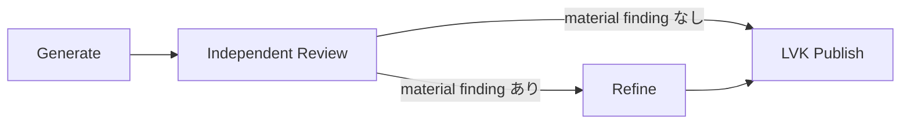

# OpenWiki の初期生成・同期・回復

OpenWiki maintenance は、統合済みソースから canonical Wiki を更新する専用作業である。通常の coding Workspace が生成する Change Manifest、Source checkpoint、receipt の意味は [Repository memory](../concepts/repository-memory.md) に集約する。ここでは、その入力を Wiki に反映する実行と回復を扱う。

## 開始条件と通常 Sync

Repository settings で有効化し、統合先の **local branch** と出力言語を選ぶ。開始処理は未解決の source integration を拒否し、未処理 event の統合 commit が選択 branch に入っていることを確認する。remote branch 自体を公開先にはできない。必要な source が未取得なら model を開始せずエラーにする。[開始前の検証](../../crates/server/src/routes/openwiki.rs)

初期生成かどうかは、固定した統合済み source commit に `openwiki/` の Git tree があるかで判定する。`index.md` が欠けた部分的な import も既存 Wiki として保持し、dirty checkout にだけあるファイルは判定に使わない。Repository settings の入口では tree 不在なら Bootstrap、存在すれば通常 Sync を選ぶ。外部 MCP の同期入口は tree 不在を拒否し、暗黙の Bootstrap を開始しない。通常 Sync は一つの Codex Session / AgentRun による reconciliation であり、Bootstrap の独立 Review を毎回実行するものではない。[存在判定](../../crates/services/src/services/openwiki.rs#L300-L303)・[部分importとdirty fileの回帰](../../crates/services/src/services/openwiki.rs#L517-L533)・[分岐](../../crates/server/src/routes/openwiki.rs#L295-L320)

開始時の存在判定と公開時の完成条件は異なる。公開候補には finalised `openwiki/index.md` が必要であり、部分importを既存Wikiとして受け入れることは、そのまま公開可能という意味ではない。[公開条件](../../crates/services/src/services/openwiki.rs#L333-L346)

利用手順と依存条件は [OpenWiki repository memory](../../docs/workspaces/openwiki.mdx) を参照する。文書は pinned OpenWiki と Node.js 22 以上、既存 Codex 認証を用いる構成を定める。LVK の version 検査は CLI の help banner を読み、固定版との完全一致を要求する。--version が exit 0 になるだけでは互換性の確認にならない。[利用条件](../../docs/workspaces/openwiki.mdx)・[version 検査](../../crates/services/src/services/openwiki.rs)

LVK の準備処理は public Codex integration を --force なしで準備する。変更された user 設定を上書きせず conflict とする方針が code comment に記録されている。maintenance thread は public MCP の `openwiki mcp --host codex` を必須として設定し、turn / Goal 開始前に実際の lifecycle tool catalog を確認する。[準備境界](../../crates/services/src/services/openwiki.rs)・[thread 設定](../../crates/executors/src/executors/codex.rs)・[起動前確認](../integrations/agent-providers.md#coding-agent--外部-mcp-server)

Codex の TOML editor が project trust table を追加すると、OpenWiki の閉じ marker だけがファイル末尾へ移る場合がある。LVK の準備処理は installer の前にこの限定されたずれを修復する。単一 marker pair、既定の MCP command/args、同じ解析済み TOML 値を確認し、利用者の設定値は変更しない。custom MCP 値・曖昧な marker は修復せず installer の conflict として残す。[原因と修復条件](../../crates/services/src/services/openwiki/codex_config.rs#L1-L48)

修復は native settings lock 下で symlink・hardlink・2 MiB超の非通常入力を拒否し、permission を維持した一時ファイルの同期後、元内容が変わっていないことを再確認して置換する。これは LVK が maintenance 起動前に行う準備であり、writer が設定ファイルを直接修正する手順ではない。[ファイル境界](../../crates/services/src/services/openwiki/codex_config.rs#L50-L92)、[再現・冪等性・拒否テスト](../../crates/services/src/services/openwiki/codex_config.rs#L95-L156)

開始時は同じ Git storage の正式統合が publishing / post_processing / recovery_required にあれば拒否する。source が見えていても、その公開結果や semantic outbox が未確定の間に Wiki を先へ進めない。[正式統合との境界](../../crates/server/src/routes/openwiki.rs)

両経路とも [実行専用 Workspace](../concepts/workspace.md#操作用途と実行所有者)を作り、起動前に owner を保存する。通常 Sync は選択 event と Memory の凍結入力を作り、その digest/source/event 集合を host state に保存してから AgentRun を予約・所有者へ bind する。[準備と起動の順序](../../crates/server/src/routes/openwiki.rs)、[Sync の入力と予約](../../crates/server/src/routes/openwiki.rs)。全 manifest/chunk の読取、未統合 Memory の権威、空入力の意味は [凍結入力の契約](../concepts/repository-memory.md#sync-の入力は統合済み-source-に結び付く凍結-snapshot)を参照する。

明示 Sync の対象は現在の統合ソース全体、または指定 SHA からの範囲である。SHA は選択 branch の祖先である必要があり、初期生成に開始 SHA は指定できない。範囲外 event の扱いと未確認領域は [Repository memory](../concepts/repository-memory.md) の契約に従う。[scope 解決](../../crates/services/src/services/openwiki/sync_scope.rs)

準備 future は Workspace lifecycle barrier 内で archive 状態を再確認して RAII 予約を取得する。installer 待機など AgentRun/Workflow がまだない期間も [手動 archive の busy 判定](../concepts/workspace.md#archive削除期限-cleanup)で保護し、future の完了・error・cancelで解放する。AgentRun終端後も repository state の active_run_id/bootstrap が残る host finalizing は archive 不可である。単に usage ラベルが execution_only という理由で永久に拒否する方式ではない。[準備の寿命](../../crates/server/src/routes/openwiki/preparation.rs#L1-L41)・[呼出位置](../../crates/server/src/routes/openwiki.rs#L384-L413)・[未完了所有の照合](../../crates/server/src/routes/workspaces/archive.rs#L45-L124)

## 開始元 Project と保守 Issue

保守の所有単位は Repo のままだが、Project 設定からの Initialize / Sync は選択中の `project_id` を任意フィールドとして共通受付へ渡す。外部 MCP Sync も認可済みの Project を渡す。これにより、複数 Board が同じ Repo を使う場合でも開始元を失わず、その Project の通常 Issue と保守 Workspace を関連付けられる。[UI の引継ぎ](../../packages/web-core/src/shared/dialogs/settings/settings/RemoteProjectsSettingsSection.tsx#L1471-L1482)・[共通フォーム](../../packages/web-core/src/shared/dialogs/settings/settings/RepositoryMemorySettings.tsx#L73-L95)・[MCP adapter](../../crates/server/src/remote_mcp/repository_wiki.rs#L214-L233)

明示 Project は実在し、`project_creation_repository_ids` に対象 Repo が含まれる必要がある。この集合は明示 Repo binding・既存 Issue/Workspace の関連に、Git 方式の保存済み `ProjectRepoDefaults` を加える。したがって開発 Card がまだない Project でも Git 作業先の既定値で関連を証明できる。directory 方式の defaults に残った Repo 値や、削除済み Project の Scratch だけでは認めない。受付時に加え、repository lock や version 検査の待機中に設定が変わり得るため紐付け直前にも検証する。[存在と再検証](../../crates/server/src/routes/openwiki/project_context.rs#L6-L43)・[関連集合](../../crates/server/src/routes/local_remote.rs#L3390-L3413)・[既存関連](../../crates/server/src/routes/integrations/mod.rs#L130-L150)

| 開始文脈 | 保守 Issue の扱い |
| --- | --- |
| 有効な明示 Project | その Project を選ぶ。共有 Repo の他候補へ推測で振り分けない |
| Repo 単独設定・自動 Sync・旧 client の未指定 request | `project_repos` と既存 Issue/Workspace の Repo 関連から Board が一つだけなら作る。候補ゼロ・複数なら Issue なしで継続する |
| 選ばれた Project に可視 status がない | Issue なしで継続する。可視 status があれば `sort_order,id` 順の先頭を使う |
| Workspace に既存 link がある | 付け替えない |

Issue 採番と link 作成は `BEGIN IMMEDIATE` transaction 内で行い、その前後で既存 link を再確認する。過去 Workspace の起動時補完は明示 Project を持たない一意 Board の規則を保ち、定期 release monitor は利用者が解除した link を再生成しない。**すべての保守 Workspace に Issue があるという保証ではない**。これは Repo 単独・共有 Repo の既存利用を保つ互換契約として運用文書にも記録されている。[link と transaction](../../crates/services/src/services/workspace_usage/lifecycle.rs#L37-L127)・[過去補完](../../crates/services/src/services/workspace_usage.rs#L135-L149)・[運用契約](../../docs/workspaces/openwiki.mdx#understand-initial-generation)

削除済み・無関連の明示 Project はエラーとなる。Project の存在と **Configure project working location** の保存済み Repo を確認する。Issue が必要なのに可視 status がない場合は、Project 設定で追加または表示してから後の実行を開始する。MCP はこれに加えて接続の Project 認可を保ち、共通受付後のエラーを安全な再実行と即断しない。[検証エラー](../../crates/server/src/routes/openwiki/project_context.rs#L6-L24)・[MCP の不確実な受付](#不確実な結果と検証の境界)

変更時は [in-memory DB fixture](../../crates/server/src/routes/openwiki/project_context.rs#L45-L270)を入口に、Bootstrap/Sync の両 owner、defaults のみの関連、削除・無関係 Project、共有 Repo、指定なし、status なし、Session 作成までを確認する。[UI fixture](../../packages/web-core/src/shared/dialogs/settings/settings/RepositoryMemorySettings.test.tsx#L86-L107)は Initialize/Sync の Project 伝播と未指定 request、[MCP fixture](../../crates/server/src/remote_mcp/launch_tests.rs#L595-L659)は別 Project の認可拒否と引継ぎを扱う。これらは実モデル生成・Wiki 公開・実ブラウザーや外部認証の成功を証明しない。

## MCP から既存 Wiki を同期する

外部会話からの同期は UI の maintenance を開始する adapter であり、OpenWiki 自身の `openwiki_begin` などを公開する入口ではない。[外部 MCP の認証と scope](../integrations/remote-access.md#repository-wiki-の同期を依頼する)を通り、既存 `LaunchActions` が共通の status / admission を呼ぶ。保存済みの出力言語と Codex 実行経路を使い、別 scheduler・モデル選択・初期生成を追加しない。[接続先](../../crates/server/src/remote_mcp/launch.rs#L161-L166)・[同期 adapter](../../crates/server/src/remote_mcp/repository_wiki.rs#L199-L231)

1. `list_projects` / `list_project_repositories` で実在する ID を確認し、`get_repository_wiki(project_id, repository_id)` を読む。状態と `current_source_commit` は UI 共通の `status_snapshot` が同じ観測 HEAD から導出する。読取は初期化・reconciliation・state 保存を行わない。この結果は live 観測であり、後続受付まで source が不変である保証ではない。[read-only snapshot](../../crates/server/src/routes/openwiki.rs#L101-L139)
2. `sync_repository_wiki` に同じ Project / repository、安定した `request_id`、観測した `target_branch` を `expected_target_branch`、40桁の `current_source_commit` を `expected_source_commit` として渡す。`from_commit` を省けば current_source、4–40桁の SHA を渡せば共通の祖先検証による since_commit となる。[入力](../../crates/server/src/remote_mcp/repository_wiki.rs#L94-L117)・[scope 解決](../../crates/services/src/services/openwiki/sync_scope.rs#L8-L45)
3. 応答を失った場合は入力と元の request ID を保ち、`get_operation` または `get_repository_wiki_sync(project_id, repository_id, request_id)` で読み戻す。後者は検証済み principal の receipt を Project・operation・repository と照合する。別 actor や別 repository の request を流用しない。[結果読取](../../crates/server/src/remote_mcp/repository_wiki.rs#L135-L186)

共通 maintenance lock の下で、保存 branch と現在 source が期待値に一致すること、有効化済み、active AgentRun / Bootstrap がないことを確認する。未解決 Integration・local branch・公開の guard も UI と共通である。古い対象なら現在状態を再確認して新しい判断を行う。Wiki がない場合は Repository settings で明示初期化する。無効化や active owner を回避する別起動経路ではない。[受付と対象検査](../../crates/server/src/routes/openwiki.rs#L219-L330)

### 受付・実行・公開・現在鮮度を分けて読む

`get_repository_wiki_sync` は `admission`、`execution`、最新の `repository` を分けて返す。これは三者全体の atomic snapshot ではない。受付 `succeeded` は実行が受理されたことだけを意味し、返る `execution_accepted:true` と `wiki_complete:false` を混同しない。[応答の組立](../../crates/server/src/remote_mcp/repository_wiki.rs#L151-L231)

`execution.wiki_complete` は、receipt の Workspace owner が対象 Repo / Run の `OPENWIKI_SYNC` と一致し、AgentRun が同じ Workspace に所属したうえで、AgentRun succeeded、publication checkpoint 存在、保存された owner result succeeded、repository の active_run_id が当該 run ではない、という条件をすべて要求する。checkpoint だけでは公開 intent、AgentRun 成功だけでは host の照合前である。host は run 固有結果を owner に保存してから receipt・最新 pointer を確定するため、その間は `host_finalizing:true` のままになる。[所有 identity と完了条件](../../crates/server/src/remote_mcp/repository_wiki.rs#L250-L305)・[保存順](../../crates/server/src/routes/openwiki.rs#L624-L647)

過去の実行完了は現在の freshness を保証しない。`repository.status`、現在 source と成功時 source / Wiki commit、active owner、範囲限定の `unverified_before` を併せて確認する。`needs_sync` は Stale / Error の補助値で、直ちに再起動してよいという判定ではない。詳細は [Repository Memory の鮮度と receipt](../concepts/repository-memory.md#並行性receipt失敗)を参照する。[現在状態の応答](../../crates/server/src/remote_mcp/repository_wiki.rs#L199-L211)

### 不確実な結果と検証の境界

受付 task が `wiki_sync` に入った後の error は、準備中に writer を予約済みかもしれないため `uncertain` とする。同じ request の再送で実行を繰り返さず、異なる入力で同じ key を使えば拒否する。現在の maintenance ID と既存実行を確認し、回復後に必要な再同期だけを新しい request として判断する。受付時の repository 再照合失敗は `repository_unavailable`、実行 ID 不在は `admission_not_confirmed`、owner / Run / store 証拠の読取失敗は `evidence_unavailable` であり、いずれも成功へ補完しない。[保守的な受付](../../crates/server/src/remote_mcp/repository_wiki.rs#L118-L174)・[入力固定と再起動](../../crates/server/src/remote_mcp/operations.rs#L208-L245)

公開用診断は固定の error code と安全な message に制限し、private path、provider の生ログ、動的な内部エラー列を返さない。詳細は既存 maintenance execution の画面で確認する。読取 tool は結果を観測するだけで、publication や reconciliation を進めない。[診断境界](../../crates/server/src/remote_mcp/repository_wiki.rs#L234-L247)・[共通 message](../../crates/server/src/remote_mcp/errors.rs#L1-L8)

変更時は [古い対象・Wiki 不在・active owner の拒否](../../crates/server/src/routes/openwiki.rs#L901-L927)、[権限・所属・同時再送・uncertainty保持・証拠欠落](../../crates/server/src/remote_mcp/launch_tests.rs#L595-L745)、[Agent成功と公開 intent だけでは完了せず、再同期後も旧失敗を保持する fixture](../../crates/server/src/remote_mcp/repository_wiki.rs#L316-L415)、[HTTP write / merge scope の分離](../../crates/server/src/remote_mcp/tests.rs#L317-L342)を入口にする。Git 公開自体の回復・source drift・no-op は [既存サービスの試験](../../crates/services/src/services/openwiki.rs#L470-L564)で別に扱う。これらの fixture は実 Auth0 / ChatGPT や実モデルの Wiki 品質を証明しない。

## Bootstrap の phase と所有権

Bootstrap は repository scope の system Workflow で、Issue 専用 WorkflowAttempt と区別される。`workflow_runs.issue_id` / `attempt_id` を設定しない内部所有形式と、保守 Workspace に付く通常 Board Issue の link は別である。[予約の保存](../../crates/server/src/workflow_runtime/runner.rs#L1064-L1100)専用 Workspace と開始 source を共有し、phase ごとに新しい Session と AgentRun を使う。global template を書き換えず run の graph を予約する。[設計上の区別](../../docs/design/openwiki-bootstrap-implementation.md#compatibility-decisions)・[予約](../../crates/server/src/workflow_runtime/bootstrap.rs)・[fresh Session の検証](../../crates/server/src/workflow_runtime/bootstrap.rs)

| Phase | 役割と完了条件 |
| --- | --- |
| Generate | init を開始し、その run の finish=complete を証明する。完了後の明確な矛盾は任意の強制 update で修正できる |
| Review | 独立した source 探索と Wiki coverage 確認。JSON の finding と verdict を返し、host が全文を検証・保存する |
| Refine | finding ごとに独立証拠で fixed / refuted / already_satisfied を説明する。fixed は完了した強制 update が必要 |
| Publish | LVK が phase 結果・source・復元済み instructions・Wiki-only 変更を検証し、既存公開処理を実行する |

[phase 検証](../../crates/server/src/workflow_runtime/bootstrap.rs)・[Publish の検証](../../crates/server/src/workflow_runtime/bootstrap.rs)

Repository owner は phase 間も維持される。既存の repository recovery monitor が lock 下で進め、普通の Workflow watcher が独立して進行させない。[進行の境界](../../crates/server/src/workflow_runtime/bootstrap.rs) 実装する scheduler と outbox の関係は [Workflow Runtime](../architecture/workflow-runtime.md) を参照する。

## 共通文書索引は探索の入口であって網羅性証明ではない

host は固定した source SHA の Git 追跡ファイルから、Generate dispatch 前に一度だけ文書索引を作る。保存済み graph と実 dispatch の両方に、同じ run の参照と短い利用指示を渡す。共有するのはファイルの所在・形式・静的見出し・原文行位置であり、Generator の選別・解釈・計画ではない。保存先と記憶層との区別は [Repository Memory](../concepts/repository-memory.md#bootstrap-の索引レポートは記憶の正本ではない)を参照する。[前処理と graph](../../crates/server/src/workflow_runtime/bootstrap.rs)、[dispatch 時の読込](../../crates/server/src/workflow_runtime/bootstrap.rs)

`docs/` に限定せず文書候補を列挙し、生成 `openwiki/`、既存の常時除外ディレクトリ、setup byproduct は含めない。AGENTS.md / CLAUDE.md は `instruction_only` として区別し、symlink・submodule を辿らない。Markdown / MDX 以外の対応文書もファイル単位で存在を残す。[候補と除外](../../crates/services/src/services/openwiki/inventory.rs)、[各ファイルの分類](../../crates/services/src/services/openwiki/inventory.rs)

Markdown と静的 MDX は `markdown-rs` の MDAST を使う。原文 snapshot と worktree の内容が一致する場合だけ見出し位置を載せる。MDX の JSX 内にある Markdown 見出しは解析対象だが、ESM import や式がある場合はファイル全体を理由付き `file_only` とし、JavaScript・repository の設定・プラグインを実行しない。巨大ファイル・位置不一致・解析失敗・見出しなしも、消さずに理由を記録する。これは動的な描画結果の索引ではない。[内容照合](../../crates/services/src/services/openwiki/inventory.rs)、[parser と静的文字列](../../crates/services/src/services/openwiki/inventory.rs)

対象 snapshot に `.openwikiignore` がある場合、0.5.1 の互換な公開選別 API がないため **索引利用不可** として従来の独立探索へ戻る。独自 matcher で代用せず、件数不明を候補ゼロとも扱わない。snapshot と worktree の ignore が不一致なら失敗する。[ignore 判定](../../crates/services/src/services/openwiki/inventory.rs)、[利用不可の通知](../../crates/services/src/services/openwiki/inventory.rs)

索引は manifest と番号付き chunk から成り、host の `workflow_runs.input_text` に identity・digest を固定する。dispatch 前・各 child 完了時・publication 前に全 chunk を検証し、欠落・改変・別 run の参照を拒否する。Agent の書込禁止は指示と工程境界での検知であり、完全な OS 隔離や途中変更後の復元を検出する保証ではない。[host 入力](../../crates/server/src/workflow_runtime/bootstrap.rs)、[全体検証](../../crates/services/src/services/openwiki/inventory.rs)、[完了時](../../crates/server/src/workflow_runtime/bootstrap.rs)、[公開前](../../crates/server/src/workflow_runtime/bootstrap.rs)

両 Agent は manifest と全 chunk を分割して読み、必要な原資料と source を独立に調べる契約を持つ。候補ゼロでも通常の Generate / Review を続ける。索引の作成完了、Agent の読取、Wiki の意味的網羅性は別であり、名前やリンクがあるだけで coverage を満たしたとは扱わない。重要な未確認領域は既存の summary に残す。[役割別の利用指示](../../crates/services/src/services/openwiki/inventory.rs)

## Writer の操作と完了証拠

writer は同じ root host で begin → plan → next_page → ページ執筆 → submit_page を順に進め、全 page 完了後に finish する。LVK は公開 MCP の呼び出し開始・完了を Native Audit から照合する。同時 call、開始記録のない完了、別 root thread の writer、食い違う重複結果は拒否する。[認められる tool と直列性](../../crates/services/src/services/openwiki/completion.rs)

登録済み MCP が利用不能なとき、自作の shell / stdio / SDK bridge で別プロセスを起動して代用しない。正しく Markdown を生成できても、その経路では LVK が必要とする native MCP call event を証明できないためである。host prompt は迂回せず連携エラーを報告するよう要求し、起動前の tool discovery で早期に確認する。[host の契約](../../crates/services/src/services/openwiki.rs)、[事前確認の実装](../../crates/executors/src/executors/codex/client/openwiki.rs)

Bootstrap での重要な規則は次の通り。

- Generate は **この phase 内で完了した init** を必要とする。begin-noop は初期生成の完了証拠にならない。
- init 完了後の修正と Refine の執筆は update + force=true を使う。新しい init で修正しない。
- page / finish の recoverable validation error は同じ active run 内で訂正できる。開始した run が未完了なら、後の成功で隠せない。
- finish は status=complete を必要とし、sourceChanged=true を拒否する。成功した強制 update に Git diff は必須ではない。

[完了必須](../../crates/services/src/services/openwiki/completion.rs)・[finish と再 begin](../../crates/services/src/services/openwiki/completion.rs)・[diff 不要の記録](../../docs/design/openwiki-bootstrap-implementation.md#phase-completion-contract)

Bootstrap writer と通常 Sync は共通の `PhaseCompletionProof` を使う。LVK は最新 attempt だけでなく、AgentRun の全 RunAttempt を順番に読み、identity、終了、audit integrity、時間的な重複を確認する。各 attempt の root thread は、その attempt 自身の thread start/resume 応答で束縛する。missing audit は「何もしなかった」の証明にはならない。[DB と audit の照合](../../crates/server/src/routes/openwiki/completion.rs)・[root の束縛](../../crates/services/src/services/openwiki/completion.rs)

最新 attempt の terminal 投影と process-exit 登録が競合する場合だけ、spawned/running の登録を最大10秒未満の pending として再観測する。古い未終了 attempt や unreachable host にはこの猶予を与えない。[終了待ち](../../crates/server/src/routes/openwiki/completion.rs)・[focused test](../../crates/server/src/routes/openwiki/completion.rs)

自動起動の pending_changes Sync は init を許さず、完了した update、または未完了操作のない非 force update に対する監査済み begin-noop を必要とする。この経路では force は必須ではない。一方、利用者が開始する current_source / since_commit は明示的な reconciliation であり、既存 checkpoint が一致しても update + force=true と finish=complete が必要となる。修正不要なら空の plan で lifecycle を完了し、begin-noop では代用しない。完了した update を複数回行うことはできる。noop で先行の未完了 run を隠すことや、別 attempt に未閉鎖操作を持ち越すことはできない。sourceChanged は absent/false のみ受け入れる。[phase ごとの条件](../../crates/services/src/services/openwiki/completion.rs)、[begin と noop](../../crates/services/src/services/openwiki/completion.rs)、[Sync の回帰テスト](../../crates/services/src/services/openwiki/completion.rs)

成功した Sync は共通の操作証明に続いて凍結入力の identity/digest を検証し、instructions を復元してから Wiki 公開へ進む。AgentRun の終端投影や Markdown が存在することだけでは成功しない。[終了処理の順序](../../crates/server/src/routes/openwiki.rs)

## 独立 Review と finding の解決

Review は generator の会話や upstream Workflow context を受け取らない。Codex thread は read-only、OpenWiki MCP / Skill は無効化され、共有 user 設定を変更しない。開始前の dirty worktree を内容 fingerprint として保存し、完了時に同一性を確認する。「Review 開始時に Git diff が空」であることは要求しない。[独立性の意図](../../docs/workspaces/openwiki.mdx)・[thread isolation](../../crates/executors/src/executors/codex.rs)・[baseline](../../crates/server/src/workflow_runtime/bootstrap.rs)・[変更検出](../../crates/server/src/workflow_runtime/bootstrap.rs)

CoverageReview は version 1 の閉じた JSON。material finding が一つでもある場合に限り `needs_refinement` と一致させ、minor だけで Refine を起動しない。**指摘件数の quota や、通常 Workflow の12,000文字 handoff に収める制約はない**。prompt / JSON schema は件数・項目長の上限を示さず、根拠のある独立した不足を省略しないよう要求する。一方、host は資源防御として JSON 全体の1 MiB超過を parse 前に拒否する。これは執筆目標ではなく、超過時に勝手に切り詰めて PASS にする処理もない。[parse と verdict](../../crates/services/src/services/openwiki/bootstrap.rs)、[Reviewer 指示](../../crates/services/src/services/openwiki/bootstrap.rs)

Reviewer はファイルを書かず、最終 JSON を返す。host が検証後に全文を共有 report へ保存し、node output は source/run/Session/AgentRun/phase identity、digest、verdict と件数の小さな参照にする。Refiner の実 dispatch はこの凍結ファイルの path を渡し、全 finding を分割読取させる。PASS でも publication 前に Review を再検証し、REFINE では処置結果も再検証する。改変・欠落を新しいファイルで隠して進めない。[保存](../../crates/server/src/workflow_runtime/bootstrap.rs)、[Refiner 入力](../../crates/server/src/workflow_runtime/bootstrap.rs)、[publication 再検証](../../crates/server/src/workflow_runtime/bootstrap.rs)

RefinementReport の findingIndex は frozen Review の0始まり index。全 material finding に一つずつ resolution が必要で、未知・重複 index は拒否する。各 resolution に独立した source/doc evidence を要求し、fixed / already_satisfied には Wiki page path も要る。Wiki 自身、生成 instructions、symlink や存在しない file を独立証拠として通さない。[report の検証](../../crates/services/src/services/openwiki/bootstrap.rs)

Refine が update を行わず全 material finding を refuted / already_satisfied とすることもできる。その場合は setup 復元後の fingerprint が Review baseline と同じでなければならない。[update と変更の関係](../../crates/server/src/workflow_runtime/bootstrap.rs)

生成・レビュー・更新の品質基準は「重要概念・契約・通常操作の説明先が安定し、初見の読者が断片を再構成せず理解できること」。概念ページ、横断 workflow、実装 architecture は異なる問いを扱い、詳細契約の正本を一か所へ置いて本文中の意味あるリンクで結ぶ。固定ディレクトリ・最低ページ数・一名詞一ページは要求しない。Generate だけに架空製品の構成例を渡し、Review はその形への準拠ではなく開発判断に影響する不足を評価する。通常 Sync も既存の説明先と関連リンクを維持する。[共通原則](../../crates/services/src/services/openwiki.rs)、[計画例と Review](../../crates/services/src/services/openwiki/bootstrap.rs)、[Sync](../../crates/services/src/services/openwiki.rs)

schema、path、operation の検査が証明するのは構造と監査上の閉包であり、推論の正しさや repository 全体の意味的網羅ではない。実装記録もこの限界を明記する。[検証の限界](../../docs/design/openwiki-bootstrap-implementation.md)

## 公開・復元・失敗回復

agent phase は source HEAD を動かさない。LVK は phase 境界で setup journal から元の instructions を復元する。復元前後に予期しない編集を検出すると、その内容を保全して失敗する。journal がない場合に元内容を推測して再生成しない。[復元](../../crates/services/src/services/openwiki/setup.rs)

公開候補は user-authored openwiki/INSTRUCTIONS.md の一致を検証し、upstream setup byproduct を除外、canonical Wiki 以外の変更を拒否する。AGENTS.md / CLAUDE.md の生成 setup を writer が途中で手動復元する運用ではなく、host 終了後の LVK の責務である。[公開候補の検査](../../crates/services/src/services/openwiki.rs) 公開 checkpoint と source drift の詳細は [Repository memory の統合・公開](../concepts/repository-memory.md) を参照する。

失敗・取消・server 再起動のとき、Bootstrap は CleaningUp に入り、新しい有料 phase を自動再開しない。通常の監査付き Cancel を送信し、残存 active run がなく、全 child の全 attempt の実終了を確認してから instructions を復元する。利用者の取消なら Workflow を Canceled、それ以外の失敗なら Failed にして owner を解放する。Stop 要求を送っただけで所有権を消してはいけない。[cleanup](../../crates/server/src/workflow_runtime/bootstrap.rs)・[再起動時の fence](../../crates/server/src/workflow_runtime/bootstrap.rs)・[未終了 child を保持する test](../../crates/server/src/workflow_runtime/bootstrap_tests.rs)

Sync の cleanup も所有 identity と全 attempt の実終了を先に確認する。失敗した terminal attempt が reserved のままで endpoint/token/host PID/provider PID を一切持たない場合は、未 spawn または開始失敗後の cleanup として復元だけを許すが、成功証明には使わない。missing registry、unreachable、古い未終了 attempt、復元失敗は `MaintenanceFenced` とし、Error 診断と active owner を残す。最新終了記録の短い待機だけは `CompletionPending` として再観測する。[終了と fence](../../crates/server/src/routes/openwiki/completion.rs)、[所有を保った回復](../../crates/server/src/routes/openwiki.rs)

Sync の確定結果は Workspace owner に保存してから repository の最新 pointer と receipt を更新する。後続保守で repository state が変わっても、その実行の成功・取消・失敗、no-op、Wiki commit を履歴として確認できる。[結果保存の順序](../../crates/server/src/routes/openwiki.rs)

既に durable publication checkpoint がある場合は、その Git 公開と receipt だけを回復する。途中の model phase を再実行して別成果物を重ねる回復ではない。ユーザー向けの状況確認は Repository settings と View Workflow の Canvas / Dashboard、失敗修正後は新しい Bootstrap が入口となる。[運用手順](../../docs/workspaces/openwiki.mdx)・[checkpoint 回復](../../docs/workspaces/openwiki.mdx)

## 設計文書の読み方

[Bootstrap v2](../../docs/design/openwiki-bootstrap-workflow-v2.md) が基本の設計、[implementation record](../../docs/design/openwiki-bootstrap-implementation.md) が phase completion の一部を明示的に更新した記録である。後者は「最後の mode だけで判断」「Refine は必ず操作する」という旧前提を置き換える。source の PhaseCompletionProof と対応して読む。

回帰検証の入口は、[全 attempt の audit を検査する test](../../crates/server/src/routes/openwiki/completion.rs) と、[Generate self-correction / 操作なし Refine の test](../../crates/server/src/routes/openwiki/completion.rs)。これらは model 呼び出しなしの protocol fixture であり、意味的 coverage の保証と混同しない。
